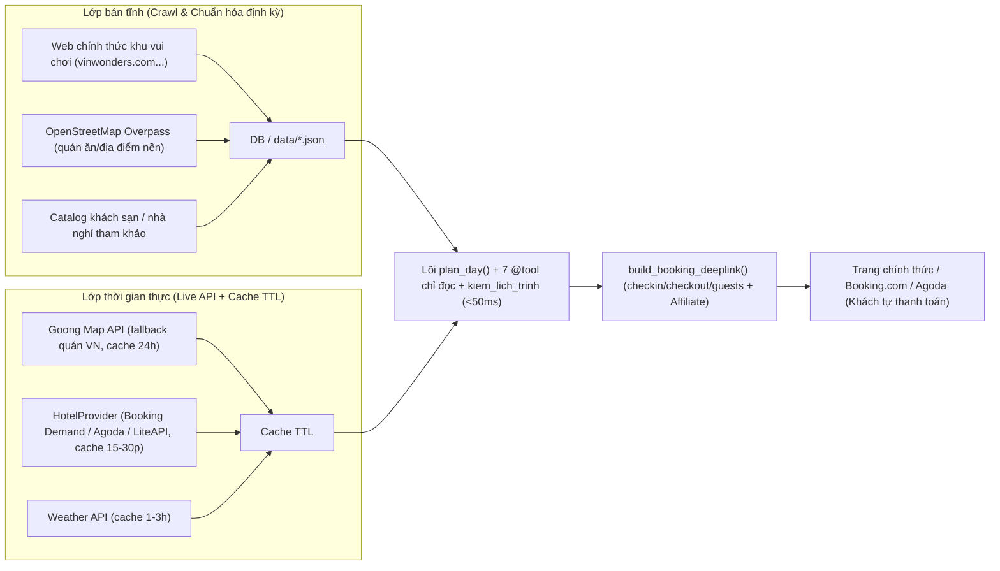

# Chiến lược dữ liệu 2 tầng — JoyPlan AI

> Tài liệu chốt kiến trúc nguồn dữ liệu cho **địa điểm tham quan / ăn uống (POI)**, **kiểm tra phòng khách sạn / nhà nghỉ kèm Deep Link đặt phòng bên thứ 3** và **hình ảnh / video chi tiết địa điểm (Hybrid Media)**, tách bạch rõ giữa **Tầng 1 (Hackathon CP3–CP4)** ổn định để chấm `eval/` và **Tầng 2 (Production mở rộng)** phục vụ vận hành thực tế.

---

## §1. Kiến trúc dữ liệu 2 tầng (Hackathon CP3–CP4 vs Production)



| Khía cạnh | Tầng 1 · Hackathon (`CP3–CP4` tối nay) | Tầng 2 · Production (Mở rộng đa điểm) |
|---|---|---|
| **Mục tiêu cốt lõi** | Tốc độ `<50ms`/tool, 0 lỗi mạng/quota khi demo, dữ liệu xác định để `eval/` và `simulate` lặp lại được. | Cập nhật giá/phòng trống sát giờ thực, mở rộng nhiều khu vui chơi & quán ăn ngoài DB. |
| **Dữ liệu khu vui chơi & show** | `data/park_zones.json`, `attractions.json`, `shows.json`, `pricing.json`. | Crawl có lịch trình hàng tuần/tháng từ trang chính thức + đối soát tay các trường ràng buộc. |
| **Quán ăn / nhà hàng** | Top điểm ăn nghỉ đại diện trong `data/attractions.json`. | OSM Overpass làm nền + **Goong API** gọi live (cache `24h`) khi khách hỏi quán đặc thù ngoài DB. |
| **Khách sạn / nhà nghỉ** | `data/hotels.json` (tên & giá thật có nguồn, `rooms_left` mô phỏng `seed=42`, gắn nhãn rõ). | Adapter `HotelProvider` (`LiteAPI` ra mắt nhanh / `Booking Demand` & `Agoda Partner` sau khi duyệt đối tác). |
| **Đặt phòng** | Nút **Đặt phòng ↗** mở link chính thức có sẵn tham số ngày/số khách (ngoài phạm vi chấm `eval/`). | `build_booking_deeplink()` truyền sẵn `checkin`, `checkout`, `adults`, `children` + mã Affiliate tracking. |
| **Hình ảnh & Video địa điểm** | Video 100% link YouTube embed; ảnh lưu link chính thức trong `data/media.json` + fallback `onError`. | Video giữ 100% YouTube embed; ảnh có bản quyền (đối tác/Wikimedia/Places Photo) lưu tối ưu WebP trên CDN riêng + ghi nguồn. |

---

## §2. Crawl lưu sẵn hay Search trực tiếp? (Phân loại theo loại dữ liệu & TTL)

JoyPlan AI **không search trực tiếp 100% lúc lập lịch** và cũng **không thuần crawl tĩnh toàn bộ**:

- **Vì sao không thuần Search trực tiếp:** Mỗi lượt gọi search ngoài mất `2–5s` và tốn phí; kết quả trả về là văn bản rời rạc, thiếu các trường định lượng để code `kiem_lich_trinh` kiểm cứng (ví dụ: giới hạn chiều cao `120–140cm`, suất show chỉ `10–20 phút`, phân khu công viên nước đóng `18:00` sớm hơn `19:30`), đồng thời làm kết quả `eval/benchmark.csv` thay đổi ngẫu nhiên giữa các lần chạy.
- **Vì sao không thuần Crawl tĩnh (ở Production):** Tình trạng hết phòng, giá phòng theo ngày nhận/trả và mưa nắng biến động từng giờ, cần gọi API có cache ngắn hạn.

| Nhóm dữ liệu | Chiến lược | Chu kỳ làm mới / TTL | Nguồn tầng CP3–CP4 | Nguồn tầng Production |
|---|---|---|---|---|
| **1. Khu vui chơi & ràng buộc cứng** *(giờ mở cửa phân khu, lịch show, `min_height_cm`, giá vé)* | **Crawl + chuẩn hóa vào DB** | Hàng tuần hoặc trước mùa lễ | `data/*.json` (nguồn `vinwonders.com`) | Worker crawl có kiểm duyệt lưu PostgreSQL / JSON |
| **2. Quán ăn / nhà hàng phổ biến** *(quanh khu vui chơi & khách sạn)* | **Crawl nền vào DB** | Hàng tháng | Điểm ăn đại diện trong `attractions.json` | OpenStreetMap Overpass API |
| **3. Quán đặc thù ngoài DB** *(user hỏi quán chay, hải sản gần cổng…)* | **Live Search + Cache** | TTL **`24 giờ`** | Trả lời theo dữ liệu có sẵn (không bịa ngoài DB) | **Goong Map API** (cache theo `(từ khóa, tọa độ)`) |
| **4. Danh mục & vị trí khách sạn / nhà nghỉ** | **Crawl / đồng bộ catalog** | Hàng tuần | `data/hotels.json` | Catalog từ LiteAPI / OTA Partner + OSM |
| **5. Giá phòng & tình trạng còn phòng theo ngày** | **Live API + Cache** | TTL **`15–30 phút`** | `rooms_left` mô phỏng (`seed=42`) + link nguồn giá | `HotelProvider` (`LiteAPI` / `Booking` / `Agoda`) |
| **6. Thời tiết theo ngày / khung giờ** | **Live API + Cache** | TTL **`1–3 giờ`** | `data/weather.json` (`seed=42`) | Open-Meteo / Weather API theo `(lat, lng, ngày)` |

---

## §3. Khảo sát & Ma trận nguồn dữ liệu địa điểm (POI tại Việt Nam)

| Nguồn dữ liệu | Chi phí & Hạn mức miễn phí (2025–2026) | Thế mạnh | Hạn chế & Ghi chú sử dụng | Vai trò trong JoyPlan AI |
|---|---|---|---|---|
| **Crawl web chính thức khu vui chơi** | `0đ` (tự vận hành) | Duy nhất có đủ trường ràng buộc cứng (`min_height_cm`, lịch show 10–20 phút, giờ mở lệch giữa các phân khu). | Khối lượng thủ công hoặc parser riêng theo từng công viên; cần kiểm tra chéo khi đổi lịch mùa. | **Nguồn gốc cho mọi công viên** *(CP3–CP4 & Production)* |
| **OpenStreetMap Overpass API** | `0đ`, **không API key**, khuyến nghị fair-use `~10.000 req/ngày` | Giàu tọa độ, tên quán, loại hình ở khu du lịch; dùng thương mại hợp pháp theo giấy phép **ODbL** (chỉ cần ghi nguồn OSM). | Thiếu ảnh, thiếu review người dùng, giờ mở cửa nhiều quán nhỏ bị trống. | **Crawl nền quán ăn & POI toàn quốc** *(Production)* |
| **Goong Map API** *(Việt Nam)* | Miễn phí `~30.000 req/tháng` (+ credit dùng thử); vượt hạn mức rẻ hơn nhiều Google | Dữ liệu địa chỉ **hẻm/ngõ**, định tuyến và POI đặc thù tại Việt Nam rất chuẩn. | Chỉ phục vụ tốt phạm vi Việt Nam, ít ảnh/đánh giá món ăn so với Google. | **Live Fallback cho quán đặc thù tại VN** *(Production, cache `24h`)* |
| **Google Places API (New)** | Hạn mức miễn phí tách theo SKU: Essentials `10.000`/tháng, Pro `5.000`/tháng, Enterprise `1.000`/tháng; vượt hạn mức khoảng `$17–$32` / `1.000` req | Đầy đủ nhất về ảnh thực tế, điểm sao review và giờ mở cửa. | Bắt buộc gắn thẻ thanh toán và dễ đội chi phí nếu gọi trực tiếp cho mọi lượt chat. | **Tuỳ chọn nâng cấp** nếu cần tự động lấy ảnh/review quán ăn |

> **Chốt luồng POI Production tại Việt Nam:** `Web chính thức (ràng buộc cứng)` + `OSM Overpass (crawl nền quán ăn)` + `Goong API (live fallback + cache 24h khi user hỏi quán đặc thù ngoài DB)`.

---

## §4. Khảo sát & Ma trận API kiểm tra phòng khách sạn / nhà nghỉ

**Kết luận khảo sát:** Hệ thống **có thể gọi API để kiểm tra phòng trống và giá theo ngày check-in/out + số lượng người lớn/trẻ em** làm đầu vào lập lịch, rồi chuyển người dùng sang hệ thống bên thứ 3 để đặt phòng — không cần tự làm cổng thanh toán.

| Phương án / API | Đăng ký & tiếp cận | Dữ liệu phòng & giá | Độ phủ khách sạn & nhà nghỉ VN | Link sang bên thứ 3 | Vai trò đề xuất |
|---|---|---|---|---|---|
| **Booking.com Demand API / Agoda Partner API** | Cần **duyệt đối tác** (xét website/ứng dụng, mất vài ngày–tuần); miễn phí theo cơ chế chia sẻ hoa hồng. | Kiểm tra phòng trống, giá net/tax, chính sách huỷ theo ngày & số khách. | **Rất cao:** phủ cả resort lớn lẫn khách sạn mini, **nhà nghỉ, homestay** bình dân tại VN. | Trả sẵn Deep Link đặt phòng gắn mã đối tác. | **Ưu tiên 1 Production** (khi đã hoàn tất duyệt đối tác) |
| **LiteAPI (Nuitée Connect)** | **Tự đăng ký lấy Sandbox & API key ngay**; trả phí theo mức dùng / chia sẻ doanh thu. | Endpoint `/hotels/rates` trả phòng trống & giá thời gian thực theo `checkin`, `checkout`, `occupancies`. | **Cao** với khách sạn/resort (`>2 triệu` cơ sở lưu trú toàn cầu); yếu hơn ở nhà nghỉ nhỏ lẻ chưa lên kênh phân phối. | Hỗ trợ whitelabel hoặc dùng Deep Link riêng. | **Ưu tiên 1 Production giai đoạn ra mắt nhanh** |
| **SerpApi (Google Hotels API)** | **Tự đăng ký lấy key ngay** (`~100` lượt tìm kiếm thử miễn phí, sau đó trả gói tháng). | Tổng hợp giá & tình trạng còn phòng Google Hotels theo ngày/khách. | **Cao**, hiển thị chéo giá từ nhiều OTA (Booking, Agoda, Traveloka…). | Trả sẵn link đích tới từng OTA / web khách sạn. | **Tuỳ chọn tổng hợp đa OTA** nếu chấp nhận chi phí theo gói |
| **Amadeus Self-Service APIs** | **Tự đăng ký lấy key ngay** (`~2.000` call/tháng miễn phí). | Chuẩn GDS: tìm khách sạn theo bán kính/tọa độ, xem phòng & giá. | Chủ yếu phủ chuỗi lớn / resort 4–5★ (hạn chế ở **nhà nghỉ nhỏ / homestay** tại VN). | Tự dựng URL hoặc chỉ dùng lấy giá tham khảo. | Phù hợp khi ghép chung vé máy bay + resort |
| **`data/hotels.json` + Deep Link** | Có sẵn ngay, `0đ`, `0` rủi ro mạng/rate-limit. | Giá tham khảo thật (có link nguồn) + `rooms_left` mô phỏng (`seed=42`). | Nhắm đúng 3–5 khách sạn thật gần cổng VinWonders Phú Quốc. | Deep Link gắn sẵn `checkin`, `checkout`, `adults`, `children`. | **Mặc định Tầng 1 (`CP3–CP4`) & tầng Fallback cuối** |

> **Lưu ý riêng cho phân khúc nhà nghỉ / homestay tại Việt Nam:** Nhà nghỉ bình dân hiếm khi nối hệ thống GDS (Amadeus), nên ở Production ưu tiên **Booking.com / Agoda Partner API** hoặc cung cấp nút Deep Link tìm theo bán kính & ngày nhận phòng kèm nhãn giá tham khảo.

---

## §5. Thiết kế kỹ thuật Adapter `HotelProvider`, Cache/TTL & Fallback 3 bậc

Công cụ `tra_khach_san` trong `codebase/tools.py` **giữ nguyên tính chất chỉ đọc (không tác động ra ngoài)** và chọn nguồn qua biến môi trường `HOTEL_PROVIDER=local|liteapi|ota_partner` (mặc định `local` cho CP3–CP4):

```python
from dataclasses import dataclass
from typing import Protocol


@dataclass(frozen=True)
class HotelQuery:
    destination_lat: float
    destination_lng: float
    checkin: str              # YYYY-MM-DD
    checkout: str             # YYYY-MM-DD
    adults: int
    children_ages: tuple[int, ...] = ()


@dataclass(frozen=True)
class HotelOffer:
    hotel_id: str
    name: str
    lat: float
    lng: float
    distance_to_gate_m: int
    price_per_night_vnd: int | None
    rooms_left: int | None
    is_realtime: bool         # False nếu đọc từ JSON tĩnh / fallback
    is_synthetic: bool        # True cho rooms_left mô phỏng (seed=42) ở CP3–CP4
    fetched_at: str           # ISO-8601 timestamp để UI hiển thị độ mới dữ liệu
    deep_link_url: str        # URL bên thứ 3 đã truyền sẵn ngày & số khách


class HotelProvider(Protocol):
    def search(self, query: HotelQuery) -> list[HotelOffer]: ...
```

### Quy tắc Cache & Fallback 3 bậc (không bao giờ làm gãy luồng lập lịch)

1. **Bậc 1 — Cache nội bộ (`<5ms`):** Khóa cache chuẩn hóa theo `(round(lat, 3), round(lng, 3), checkin, checkout, adults, tuple(sorted(children_ages)))`, thời gian sống **TTL `15–30 phút`**.
2. **Bậc 2 — Live Provider (`timeout cứng 2.5s`):** Nếu miss cache và `HOTEL_PROVIDER != "local"`, gọi `LiteApiHotelProvider` hoặc `OtaPartnerHotelProvider`; trả được kết quả hợp lệ thì ghi cache kèm `is_realtime=True`, `fetched_at=now()`.
3. **Bậc 3 — Fallback `LocalJsonHotelProvider` (`0ms`):** Nếu đang ở mode `local` (CP3–CP4) hoặc Live API timeout/vượt quota/mất mạng → trả danh sách từ `data/hotels.json` với `is_realtime=False` và UI hiển thị nhãn rõ ràng *(giá tham khảo hoặc dữ liệu mô phỏng)* để agent vẫn chọn được mốc xuất phát và chạy `plan_day()` bình thường.

---

## §6. Chuyển hướng đặt phòng bên thứ 3 (Deep Link, Affiliate & An toàn UX)

### 1. Sinh Deep Link truyền sẵn tham số & Affiliate tracking
Thay vì đưa người dùng về trang chủ trống của khách sạn/OTA, hàm `build_booking_deeplink(hotel, query)` điền sẵn ngày nhận/trả phòng và số người lớn/trẻ em lên URL đích:

- **Trang đối tác / OTA (Booking.com, Agoda, Vinpearl):** gắn các query param chuẩn (`checkin`, `checkout`, `group_adults`, `group_children`, `age`…).
- **Chế độ Affiliate tạo doanh thu (Production):**
  - Gắn mã đối tác trực tiếp (`aid` của Booking, `cid` của Agoda), **hoặc**
  - Bọc link qua **Travelpayouts Links API** (`POST https://api.travelpayouts.com/links/v1/create` truyền `trs` + `marker` và danh sách `links`) để tự động chuyển link đặt phòng bất kỳ thành link theo dõi hoa hồng — trong khi **JoyPlan AI vẫn không thu tiền, không giữ thẻ và không chịu trách nhiệm CSKH hủy/đổi phòng**.

### 2. Biện pháp UX chống lệch giá & hết phòng giữa lúc lập lịch và lúc đặt
1. **Minh bạch nguồn & thời điểm:** Hiển thị kèm thời gian lấy giá (`fetched_at`) và dòng nhắc *"Giá cuối cùng & phòng trống xác nhận trực tiếp tại trang đối tác"* (riêng bản hackathon bắt buộc gắn nhãn *"dữ liệu mô phỏng"* cho `rooms_left`).
2. **Giữ nguyên ngữ cảnh khi đổi khách sạn:** Nếu sang trang đối tác thấy hết phòng hoặc giá đổi, người dùng bấm **"Đổi khách sạn khác"** trên JoyPlan AI — toàn bộ thông số gia đình (số người, chiều cao từng bé, ngân sách, ngày đi) được giữ nguyên để tính lại khoảng cách cổng và tổng chi phí chỉ trong 1 bấm.

### 3. Tuân thủ pháp lý & luật Hackathon
- **Không** dùng bot giải CAPTCHA hoặc scrape vượt rào bảo vệ các trang OTA; chỉ dùng API chính thức hoặc trang công khai không chặn cùng Deep Link đối tác.
- Giữ nguyên `tra_khach_san` **ngoài phạm vi đánh giá `eval/`** để lõi lập lịch 1 ngày `answer(text)` luôn ổn định, xác định và đúng chuẩn "đạt" đã khóa ở `spec.md` §7.

---

## §7. Chiến lược Media — Hình ảnh & Video chi tiết địa điểm (Hybrid)

- **Video:** **100% chỉ lưu link YouTube embed** (`youtube-nocookie.com/embed/<id>`), tuyệt đối không tải file `.mp4` về repo Git hay server (tránh phình repo và tránh vi phạm bản quyền/ToS YouTube).
- **Ảnh (Hybrid 2 tầng):**
  - *Tầng 1 (CP3–CP4):* Lưu link ảnh chính thức trong `data/media.json` (kèm `source_url`, `caption`, `verified_date`). Frontend hiển thị bằng `` kết hợp **`onError` fallback** tự ẩn ảnh hỏng và hiện ô *"Chưa có media"* + nút *"Xem trên trang chính thức ↗"* để chống trang đích chặn hotlink (`403`) hoặc mạng yếu.
  - *Tầng 2 (Production):* Lưu & resize định dạng WebP lên **CDN riêng** (Cloudflare R2 / S3 + CloudFront) nhưng **chỉ đối với nguồn có quyền sử dụng hợp pháp**: (a) ảnh đối tác/khu vui chơi cấp phép, (b) ảnh Wikimedia Commons / Creative Commons kèm ghi tác giả & giấy phép, hoặc (c) ảnh từ Places Photo API tuân thủ điều khoản cache & attribution. Không crawl trái phép ảnh có bản quyền.

| Loại media | Tầng 1 (CP3–CP4) | Tầng 2 (Production) | Fallback & Pháp lý |
|---|---|---|---|
| **Video giới thiệu** | Link YouTube embed chính thức trong `data/media.json` | Giữ nguyên 100% link YouTube embed | Không tải `.mp4`; thiếu thì ẩn khối video / hiện link trang chính thức |
| **Ảnh khu vui chơi & show** | Link ảnh chính thức (`source_url`, `verified_date`) trong `data/media.json` | Ảnh đối tác cấp phép hoặc Wikimedia/CC lưu WebP trên CDN riêng + ghi nguồn | UI dùng `referrerPolicy="no-referrer"` + `onError` → *"Chưa có media / Xem trang chính thức ↗"* |
| **Ảnh quán ăn & khách sạn** | Dùng link chính thức nếu có nguồn rõ; thiếu thì để trống | Ảnh từ Places Photo API (đúng hạn mức cache/attribution) hoặc đối tác gửi | Không crawl/lưu ảnh bản quyền không phép; luôn ghi nguồn hiển thị |

```json
{
  "item_id": "VW-Z6-01",
  "venue_id": "vinwonders",
  "image_url": "https://vinwonders.com/.../cung-dien-hai-vuong.jpg",
  "youtube_url": "https://www.youtube-nocookie.com/embed/...",
  "source_url": "https://vinwonders.com/vi/...",
  "caption": "Cung điện Hải Vương — VinWonders Phú Quốc",
  "verified_date": "2026-11-27",
  "license_note": "Link chính thức VinWonders (CP3–CP4 chỉ dẫn link + fallback onError)"
}
```
