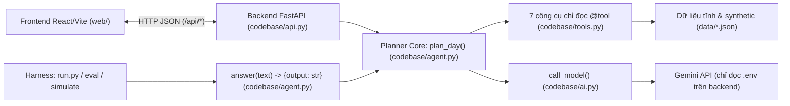

# Kiến trúc hệ thống — JoyPlan AI

> Tài liệu thiết kế kỹ thuật kết nối giao diện **JoyPlan AI (React/Vite + FastAPI)** với lõi **Planner + 7 công cụ chỉ đọc**, giữ nguyên **100% hợp đồng `answer(text) -> {"output": str}`** để `python run.py`, `python run.py eval` và `python run.py simulate` chạy đồng nhất.

---

## 1. Sơ đồ kiến trúc tổng thể



---

## 2. Nguyên tắc tách lớp & Bảo toàn Harness

Để giao diện web hiển thị bản đồ, thẻ mốc, bảng kiểm 5 điều kiện mà **không phải parse văn bản**, đồng thời không làm thay đổi cách chấm của khung hackathon:

1. **Lõi có cấu trúc (`plan_day` / `run_pipeline` trong `codebase/agent.py`):**
   - Thực hiện đủ 5 bước (Guardrail → Trích ràng buộc / G10 → Gọi công cụ đọc → Gọi Gemini lập lịch + `kiem_lich_trinh` sửa tối đa 2 vòng → Trả `dict` dữ liệu chuẩn gồm danh sách mốc, tổng chi phí, kết quả kiểm 5 điều kiện, `steps[5]`).
2. **Điểm vào CLI & Eval (`answer(text) -> {"output": str}`):**
   - Giữ nguyên chữ ký và hành vi cho `run.py`, `eval/run_eval.py`, `cost/simulate.py`: gọi lõi trên 1 ngày rồi định dạng thành chuỗi văn bản `output`.
   - Phần mở rộng **Ngày 2 / Ngày 3** trên web chỉ là vòng lặp gọi lại đúng hàm lõi `plan_day` theo từng ngày (kèm tham số ngày/thời tiết), **không** làm phình logic được chấm ở `answer(text)`.
3. **Điểm vào Web (`codebase/api.py`):**
   - Khởi tạo/cập nhật phiên người dùng, xử lý bước chọn thẻ khách sạn tham khảo (ngoài phạm vi đánh giá) và các thao tác tương tác trực tiếp trên UI (`swap`, `remove`, `undo`).

---

## 3. Danh sách 7 công cụ chỉ đọc (`codebase/tools.py`)

Tất cả công cụ đều gắn `@tool`, đọc dữ liệu từ `data/` và **không có tác động ra ngoài** (`Không`).

| # | Tên công cụ | Input | Output chính | Tác động ra ngoài? | Phạm vi chấm |
|---|---|---|---|---|---|
| 1 | `tra_diem_choi` | `phan_khu`, `chieu_cao_min`, `trong_nha`, `tags`, `mo_luc`, `gom_an_nghi`, `to_hop` | Danh sách điểm/trò khớp từ `attractions.json` (kèm `venue_id`, `lat`, `lng`, `min_height_cm`, `can_nguoi_lon_di_kem`; mặc định `vinwonders`) | Không | Trong phạm vi |
| 2 | `tra_lich_show` | `ngay`, `phan_khu`, `bo_qua_show`, `to_hop` | Giờ mở cửa công viên/tổ hợp, `8` phân khu, `show_kha_dung` (kèm `lat`, `lng`), `show_anh_huong_thoi_tiet` | Không | Trong phạm vi |
| 3 | `tra_thoi_tiet` | `ngay`, `khung_gio` | Trạng thái thời tiết, `co_mua`, `khung_gio_mua`, `dong_ngoai_troi`, `dong_cong_vien_nuoc` | Không | Trong phạm vi |
| 4 | `uoc_thoi_gian_di` | `khu_a`, `khu_b` | Thời gian đi bộ nội khu (`3–12p`) hoặc xe VinBus liên tổ hợp (`15–20p`), kèm `phuong_tien` từ ma trận 8×8 | Không | Trong phạm vi |
| 5 | `tinh_chi_phi` | `so_nguoi_lon`, `so_tre_em_1m_1m4`, `so_tre_duoi_1m`, `dich_vu`, `so_nguoi_cao_tuoi`, `da_co_ve`, `goi_an`, `ngan_sach_vnd`, `to_hop`, `diem_ve_le` | Chi phí vé (tự áp Combo VinWonders+Safari nếu đi cả 2, vé lẻ Grand World), ăn uống, phụ phí, `trong_ngan_sach`, `tiet_kiem_combo_vnd` | Không | Trong phạm vi |
| 6 | `kiem_lich_trinh` | `lich`, `rang_buoc` | `hop_le`, `so_vi_pham`, `vi_pham[]`, `canh_bao[]` (gồm cảnh báo quá sức đa tổ hợp), `tong_hop_chi_phi`, `goi_y_trong_nha`, `goi_y_noi_rang_buoc` | Không | Trong phạm vi |
| 7 | `tra_khach_san` *(mới)* | `ngay_den`, `ngay_ve`, `so_nguoi` | 3–5 khách sạn gần cổng từ `data/hotels.json` (giá tham khảo có nguồn, `lat`, `lng`, khoảng cách cổng, `rooms_left` mô phỏng, `booking_url`, điểm phù hợp) | Không | **Ngoài phạm vi đánh giá** (chỉ phục vụ bước 1 UX trên web) |

---

## 4. Thay đổi & Bổ sung dữ liệu (`data/` + `data/DATA_CARD.md`)

Mọi file mới hoặc trường bổ sung đều phải cập nhật nguồn, ngày lấy và nhãn `thật` / `synthetic` vào [data/DATA_CARD.md](file:///d:/workspace/VinAI/K5-Day15-L3A-Phoenix_1/data/DATA_CARD.md) (xem thêm chiến lược dữ liệu 2 tầng Crawl vs Live API, adapter `HotelProvider` & Deep Link/Affiliate tại [docs/data-strategy.md](file:///d:/workspace/VinAI/K5-Day15-L3A-Phoenix_1/docs/data-strategy.md)).

1. **Bổ sung cụm Phú Quốc United Center, toạ độ `(lat, lng)` WGS84 & GeoJSON `polygon` 8 phân khu (`[103.852..103.879, 10.313..10.338]`):**
   - `data/park_zones.json`: thêm `venues` (3 tổ hợp), `center`, `color` và `polygon` cho `8` phân khu (`Z1_EURO`..`Z6_SEASHELL`, `Z7_SAFARI`, `Z8_GRANDWORLD`) + ma trận di chuyển `8×8` (gồm đệm VinBus `15–20` phút).
   - `data/attractions.json` & `data/shows.json`: **44 điểm/ăn nghỉ** + **10 show** gắn `venue_id`, `lat`, `lng` (thuộc polygon tương ứng) và `paid_ticket_key` (điểm thu phí Grand World).
2. **`data/hotels.json` *(mới)*:**
   - Gồm 3–5 khách sạn tên thật gần cổng VinWonders / Grand World (khu Bãi Dài).
   - Các trường: `id`, `name`, `lat`, `lng` (vị trí thật gần cổng để vẽ trực tiếp khách sạn và tuyến tới cổng trên MapLibre), `distance_to_gate_m`, `price_ref_vnd`, `price_source_url` (link trang chính thức/OTA kèm ngày xem), `rooms_left` (**`synthetic`, `seed=42`** — UI luôn gắn nhãn *"mô phỏng"*), `max_guests`, `has_family_room`, `booking_url` (hỗ trợ sinh Deep Link truyền sẵn `checkin/checkout/adults/children` & affiliate tracking ở Production qua adapter `HotelProvider` cho nút **Đặt phòng ↗**), `fit_note`.
3. **`data/media.json` *(mới)*:**
   - Ánh xạ `item_id` → `image_url`, `youtube_url` (100% YouTube embed, không tải `.mp4`), `source_url`, `caption`, `verified_date`.
   - **Quy tắc Hybrid Media & chống bịa (chi tiết tại [docs/data-strategy.md](file:///d:/workspace/VinAI/K5-Day15-L3A-Phoenix_1/docs/data-strategy.md) §7):** chỉ dùng link chính thức kiểm mở được; UI render kèm `onError` fallback sang *"Chưa có media / Xem trang chính thức ↗"* (tầng Production dùng ảnh có bản quyền/đối tác/Wikimedia trên CDN riêng).

---

## 5. Thiết kế API (`codebase/api.py` — FastAPI — 9 endpoint)

| Method & Path | Input | Hành vi & Output |
|---|---|---|
| `GET /api/zones` | *(không tham số)* | Trả GeoJSON `FeatureCollection` `8` phân khu từ `data/park_zones.json` (tên, `venue_id`, mã màu, `center`, `polygon`) để frontend vẽ lớp phân khu và dùng làm nền dự phòng khi mất mạng. |
| `POST /api/chat` | `{ "session_id": str, "message": str }` | Chạy guardrail → trích/cập nhật ràng buộc phiên → nếu thiếu thông tin trả `status: "ask_more"`; nếu mới bắt đầu & đủ thông số gọi `tra_khach_san` trả `hotels[]`; nếu đã có khách sạn hoặc là câu hỏi chỉnh lịch thì chạy lại `plan_day` cho các ngày liên quan → trả `PlanResponse`. |
| `GET /api/hotels` | `?ngay_den=...&ngay_ve=...&so_nguoi=...` | Gọi `tra_khach_san` trả danh sách khách sạn tham khảo + nhãn mô phỏng. |
| `POST /api/sessions/{id}/hotel` | `{ "hotel_id": str }` | Ghi nhận khách sạn được chọn làm mốc xuất phát, sinh lịch Ngày 1..N bằng `plan_day`, đẩy snapshot vào undo stack → trả `PlanResponse`. |
| `GET /api/attractions/{id}` | `?heights=110,95` | Trả thông tin chi tiết điểm/show từ `attractions.json`/`shows.json` + media từ `media.json` + mảng `height_labels` (`✓`/`✗`) theo từng bé. |
| `GET /api/sessions/{id}/days/{n}/alternatives` | `?item_id=...` | Tìm các trò/điểm khác vừa khít khung giờ của `item_id` (lọc theo giờ mở cửa, chiều cao nhỏ nhất, trạng thái mưa của Ngày `n`, không trùng điểm đã có trong ngày). |
| `POST /api/sessions/{id}/days/{n}/swap` | `{ "item_id": str, "new_id": str }` | Lưu snapshot undo → thay `item_id` bằng `new_id` → **bắt buộc chạy lại `kiem_lich_trinh`**. Nếu phát sinh vi phạm → hoàn nguyên và trả lỗi kèm lý do; hợp lệ → trả `PlanResponse` mới kèm tin nhắn agent. |
| `POST /api/sessions/{id}/days/{n}/remove` | `{ "item_id": str }` | Lưu snapshot undo → xoá `item_id` theo **Luật xoá mốc** (mục 7) → **bắt buộc chạy lại `kiem_lich_trinh`** → trả `PlanResponse` mới. |
| `POST /api/sessions/{id}/undo` | `{}` | Pop snapshot trước đó từ undo stack của phiên → khôi phục trạng thái và trả `PlanResponse` (`can_undo` cập nhật). |

---

## 6. Schema `PlanResponse` (Hợp đồng Backend ↔ Frontend)

Backend và bộ mock `web/src/mock/plan.json` dùng đúng cấu trúc dưới đây để Frontend và Backend làm song song:

```json
{
  "session_id": "sess_abc123",
  "reply": "Mình đã xếp lịch Ngày 1 xuất phát từ VinHolidays Fiesta Phú Quốc (0 vi phạm).",
  "status": "ok",
  "missing_fields": [],
  "hotels": [
    {
      "id": "HT-01",
      "name": "VinHolidays Fiesta Phú Quốc",
      "lat": 10.3282,
      "lng": 103.8576,
      "distance_to_gate_m": 800,
      "price_ref_vnd": 1450000,
      "rooms_left": 3,
      "rooms_is_synthetic": true,
      "fit_score": 86,
      "fit_note": "Còn 3 phòng gia đình (mô phỏng) · 800m tới cổng",
      "booking_url": "https://vinpearl.com/..."
    }
  ],
  "selected_hotel_id": "HT-01",
  "days": [
    {
      "day": 1,
      "date": "2026-12-12",
      "weather": { "trang_thai": "nang_gat", "co_mua": false, "khung_gio_mua": null },
      "summary": {
        "cost_vnd": 3850000,
        "n_items": 9,
        "kid_ok_count": 4,
        "total_rides": 4
      },
      "items": [
        {
          "id": "VW-Z2-01",
          "type": "ride",
          "name": "Đu quay Thumbelina",
          "zone_id": "Z2_FAIRY",
          "start": "09:00",
          "end": "09:30",
          "lat": 10.3168,
          "lng": 103.8525,
          "cost_vnd": 0,
          "min_height_cm": 0,
          "height_labels": [
            { "child_cm": 110, "ok": true },
            { "child_cm": 95, "ok": true }
          ],
          "notes": "Trẻ dưới 100cm cần có người lớn ngồi cùng."
        }
      ],
      "check": {
        "hop_le": true,
        "so_vi_pham": 0,
        "vi_pham": [],
        "canh_bao": [],
        "dieu_kien": {
          "gio_mo_cua": true,
          "chong_gio": true,
          "ngan_sach": true,
          "chieu_cao": true,
          "mua": true
        }
      }
    }
  ],
  "steps": [
    { "step": 1, "name": "Kiểm tra an toàn đầu vào", "status": "ok", "detail": "Hợp lệ, trong phạm vi VinWonders Phú Quốc" },
    { "step": 2, "name": "Trích ràng buộc gia đình (G10)", "status": "ok", "detail": "2 lớn, 2 bé (110cm, 95cm), ngân sách 12tr" },
    { "step": 3, "name": "Gọi công cụ đọc dữ liệu", "status": "ok", "detail": "tra_thoi_tiet, tra_lich_show, tra_diem_choi, tinh_chi_phi" },
    { "step": 4, "name": "Lập lịch & kiểm cứng kiem_lich_trinh", "status": "ok", "detail": "0 vi phạm sau 0 vòng sửa" },
    { "step": 5, "name": "Tổng hợp lịch & chi phí", "status": "ok", "detail": "Đã xuất lịch kèm nhãn chiều cao từng bé" }
  ],
  "can_undo": true
}
```

- `status` thuộc tập: `"ok"` | `"ask_more"` | `"need_hotel"` | `"refused"` | `"infeasible"`.
- `items[].type` thuộc tập: `"hotel"` (nâu) | `"ride"` (xanh lá) | `"show"` (tím) | `"meal"` (cam).

---

## 7. Quản lý phiên, Hoàn tác & Luật xoá mốc

- **Phiên & Hoàn tác (Undo):** Server lưu trạng thái trong bộ nhớ (`SESSIONS: dict[str, SessionState]`). Mỗi `SessionState` giữ `constraints`, `selected_hotel_id`, `days`, `messages` và `undo_stack: list[Snapshot]` (tối đa 20 bước). Không cần cơ sở dữ liệu ngoài.
- **Lưu lịch:** Thực hiện hoàn toàn ở trình duyệt bằng `localStorage` kèm nút tải file `.json` lịch trình về máy.
- **Luật xoá mốc (`POST /api/sessions/{id}/days/{n}/remove`):**
  1. Xác định mốc đứng ngay trước mốc bị xoá (`prev_item`).
  2. Nếu `prev_item` tồn tại, **không phải** `type == "show"` (vì show diễn theo giờ cố định), và việc kéo `prev_item.end = removed_item.end` vẫn nằm trong giờ mở/đóng của phân khu `prev_item.zone_id` (và không vượt khung mưa nếu là ngoài trời) → kéo dài `prev_item.end` để gia đình đi thong thả hơn.
  3. Ngược lại (xoá mốc đầu ngày, hoặc `prev_item` là show cố định / kịch giờ đóng phân khu) → chèn hoặc giữ khoảng trống ghi nhãn *"Thời gian nghỉ / di chuyển tự do"*.
  4. Bắt buộc chạy lại `kiem_lich_trinh` trước khi trả về UI.

---

## 8. Hệ thống thiết kế UI (Design Tokens & Layout tham khảo EstateSmart)

### 8.1. Bố cục tổng thể & Chuyển động
- **Header cố định trên cùng (`height: 64px` / `h-16`, sticky):**
  - Trái: icon vuông bo góc tối `#111a24` (nét mảnh `1.5px`) + chữ **`JOYPLAN / AI`**.
  - Phải: điều hướng tối giản dạng chữ (`Trang chủ`, `Góp ý`, link xanh `#2c6ab0` `Đăng nhập` hoặc trạng thái phiên).
- **Khung chính `.stage`:**
  - Khóa gọn trong 1 màn hình: `height: calc(100svh - 88px)` (`min-height: 560px` desktop, `520px` mobile), `padding: 12px`, khoảng cách giữa các cột `12px`.
  - **Chuyển tỉ lệ mượt trên desktop (`>= 1024px`, `950ms cubic-bezier(.76,0,.24,1)`):**
    - *Màn chào mừng:* **`60%` trái** (ô nhập + gợi ý) | **`40%` phải** (bản đồ tổng quan).
    - *Khi đã bắt đầu trò chuyện:* co khung chat sang **`~29%` trái** (`clamp(340px, 29%, 420px)`) | mở rộng **`~71%` phải** cho lộ trình & bản đồ (tuỳ chọn mở cột thứ 3 `21%` / `260–320px` cho ngăn đã lưu / chi tiết khi cần).
  - **Responsive `< 1024px`:** gộp thành 1 khung có thanh `tablist` dạng viên thuốc (`Trò chuyện` | `Kết quả`), tab đang chọn nền `#111a24` chữ trắng.
  - **Cải tiến hơn EstateSmart ở trạng thái G10 (hỏi thiếu thông tin):** Cột phải **không** để trống bằng ảnh tĩnh mà luôn hiển thị sẵn **bản đồ tổng quan 8 phân khu cụm Phú Quốc United Center (VinWonders + Safari + Grand World) + 3 khách sạn gần cổng** ngay từ màn đầu và trong lúc chờ người dùng bổ sung thông tin.

### 8.2. Phong cách bề mặt & Typography
- **Bề mặt phẳng (Flat Surface):** Nền trang `#e9eff5`, thẻ panel trắng `#ffffff` bo góc `border-radius: 28px`, **không đổ bóng nặng** — tách lớp bằng nền `#e9eff5` và khoảng hở `12px`. Chỉ overlay nổi trên bản đồ mới dùng kính mờ `bg-white/95 backdrop-blur rounded-[18px] shadow-[0_10px_30px_rgba(11,17,24,.18)]`.
- **Font chính:** `Familjen Grotesk` (Google Fonts, hỗ trợ đầy đủ dấu tiếng Việt; fallback `system-ui, sans-serif`).

### 8.3. Bộ CSS Custom Properties (`web/src/styles/tokens.css`)

```css
:root {
  --bg-page: #e9eff5;
  --bg-card: #ffffff;
  --bg-soft: #f4f8fc;
  --bg-soft-hover: #eaf1f8;
  --bg-pale: #dce8f5;
  --ink: #111a24;
  --muted: #4a5664;
  --subtle: #5f6b79;
  --line-soft: #e1e8ef;
  --line: #d6dfe8;
  --line-strong: #c3ceda;
  --brand: #2c6ab0;
  --brand-dark: #1f5a9e;
  --go: #2e7d5b;
  --warn: #e07b3c;
  --stream-grad: linear-gradient(90deg, #2c6ab0, #7b6fd6, #d96570, #7b6fd6, #2c6ab0);

  /* 4 màu mốc lộ trình JoyPlan AI */
  --pin-hotel: #8b5a2b;
  --pin-ride: #2e7d5b;
  --pin-show: #6d4fc2;
  --pin-meal: #e07b3c;
}
```

### 8.4. Mẫu thành phần chat & Tương tác chính
- **Bong bóng chat bất đối xứng:** Bot nền `#f4f8fc`, bo `18px 18px 18px 4px` (`max-w-[94%]`); User nền `#111a24` chữ trắng, bo `18px 18px 4px 18px` (`max-w-[88%]`).
- **Thanh tiến trình `Quá trình xử lý · 5 bước · X s · 0 vi phạm`:** Lúc đang gọi API hiển thị thẻ 5 bước dọc kèm hiệu ứng gradient bước đang chạy; xong thì thu gọn thành 1 pill bấm mở xem từng bước + thời gian chạy.
- **Ngăn Bộ lọc nhanh (`Tìm nhanh`):** Mở inline ngay trên ô nhập với lưới 2×2 chọn nhanh **Số người · Chiều cao bé · Ngày đi · Ngân sách** + các chip ưu tiên, giúp giảm gõ tay khi demo.
- **Ô nhập `.gm-input`:** Bo pill `28px`, viền `#c3ceda` (`focus` đổi `#2c6ab0`, lúc đang gọi AI chuyển sang viền gradient `--stream-grad`), nút gửi tròn `#2c6ab0` ở góc phải.

---

## 9. Kiến trúc bản đồ MapLibre GL JS + OpenFreeMap Liberty & Dự phòng mất mạng

- **Thư viện & nguồn nền:** `maplibre-gl` (`npm i maplibre-gl`) kết hợp vector tile **OpenFreeMap Liberty** (`https://tiles.openfreemap.org/styles/liberty`, dữ liệu OpenStreetMap / OpenMapTiles — **miễn phí 100%, không cần API key**).
- **Tâm & khung nhìn:** Tâm mặc định `[103.858, 10.324]` (ôm trọn cụm VinWonders – Grand World – Vinpearl Safari), `zoom: 14.2`; khi có lịch trình tự `fitBounds` ôm trọn khách sạn và các mốc trong ngày (chừa padding hợp lý cho thanh trên & dải thẻ dưới).
- **Các lớp (Layers) vẽ đè từ dữ liệu nội bộ (`data/park_zones.json` + `PlanResponse`):**
  1. **Lớp 8 phân khu của 3 tổ hợp (GeoJSON `Polygon`):** Tô màu pastel bán trong suốt (`fill-opacity: 0.22`) + viền mảnh + nhãn tên phân khu (`symbol` layer) để người dùng nhìn rõ 6 khu VinWonders + Safari + Grand World dù OpenStreetMap chưa vẽ chi tiết từng khu.
  2. **Lớp tuyến lộ trình trong ngày (GeoJSON `LineString`):** Nối lần lượt các mốc `1 → N` theo thứ tự giờ, kèm đánh dấu hướng đi.
  3. **HTML Marker dạng Pill 4 màu:** `border-radius: 999px`, hiển thị `STT · Tên ngắn · Giờ`, áp dụng màu theo `--pin-hotel` / `--pin-ride` / `--pin-show` / `--pin-meal`; mốc đang chọn có vòng sáng tỏa (`pulse` halo).
  4. **Controls & Floating Overlays:** `NavigationControl({ visualizePitch: false, showZoom: true })` đặt góc `bottom-right` (`border-radius: 14px`, `1px solid #dfe5ec`, `box-shadow: none`), `attributionControl: { compact: true }`; nút nổi góc trên-phải **Chỉ đường trên Google Maps ↗**; nút nổi góc dưới-trái **`0 vi phạm · N lưu ý`**; bấm vào marker mở khung chi tiết kính mờ (`bg-white/95 backdrop-blur rounded-[18px] shadow-[0_10px_30px_rgba(11,17,24,.18)]`) thay cho popup tam giác mặc định của MapLibre.
- **Cơ chế dự phòng mất mạng (Offline / Weak-WiFi Fallback):**
  - Định nghĩa sẵn 1 **blank local MapLibre style** (`web/src/utils/mapFallbackStyle.js`, `version: 8`, nền `#eef2f5`, không gọi tile ngoài) chỉ chứa GeoJSON 8 phân khu + đường trục nội bộ đơn giản.
  - Khi `tiles.openfreemap.org` tải lỗi (`map.on('error')` với lỗi mạng/tile hoặc quá `3s` chưa `style.load`), `ParkMap` tự động chuyển sang local style dự phòng mà **không làm mất 8 vùng phân khu, tuyến `LineString` hay HTML marker pill**, kèm badge nhỏ *"Chế độ bản đồ ngoại tuyến"* khi fallback kích hoạt.

---

## 10. Cấu trúc Frontend (`web/` — React + Vite)

- **Thư viện cần cài trong `web/package.json`:** `maplibre-gl` và `@fontsource/familjen-grotesk` *(hoặc nhúng Google Fonts `Familjen Grotesk` trong `web/index.html`)*.

```text
web/
├── index.html                   # Nạp font Familjen Grotesk + tiêu đề JoyPlan AI
├── package.json                 # react, vite, maplibre-gl, @fontsource/familjen-grotesk
├── vite.config.js               # proxy "/api" -> "http://localhost:8000"
└── src/
    ├── styles/
    │   └── tokens.css           # Design tokens tham khảo EstateSmart (--bg-page, --brand, --stream-grad, 4 màu pin...)
    ├── utils/
    │   └── mapFallbackStyle.js  # Blank local MapLibre style (version: 8, nền #eef2f5) dự phòng mất mạng
    ├── mock/
    │   └── plan.json            # Dữ liệu mẫu khớp PlanResponse + lat/lng để phát triển song song
    ├── App.jsx                  # Header 64px, .stage 60/40 -> 29/71, tablist <1024px (ChatPanel | ItineraryPanel)
    └── components/
        ├── ChatPanel.jsx        # MessageList, HotelCards, StepsDrawer (5 bước), QuickFilterDrawer ("Tìm nhanh"), Composer, UndoBtn
        ├── ItineraryPanel.jsx   # DayTabs (Ngày 1/2/3), DaySummaryBar (chi phí, số mốc, hợp bé, Đặt phòng ↗, Lưu lịch)
        ├── ParkMap.jsx          # MapLibre GL JS + OpenFreeMap Liberty + GeoJSON 8 phân khu + HTML marker pill 4 màu + offline fallback
        ├── TimelineStrip.jsx    # Dải thẻ mốc cuộn ngang dưới bản đồ
        ├── CheckModal.jsx       # Bảng tự kiểm 5 điều kiện mở từ nút "0 vi phạm · N lưu ý"
        └── ItemDetailModal.jsx  # Khung chi tiết kính mờ: Media (YouTube embed + ảnh link kèm onError fallback "Chưa có media"), nhãn chiều cao, SwapList, nút Xoá mốc
```

---

## 11. Cách chạy dự án

- **Chế độ chấm & đánh giá chuẩn của hackathon (giữ nguyên 100%):**
  ```powershell
  python run.py check
  python run.py eval --try
  python run.py eval
  python run.py score eval/run-1.csv
  python run.py simulate --try
  ```
- **Chế độ giao diện web JoyPlan AI (sau khi hoàn thành T3 & T5–T6):**
  ```powershell
  pip install -r requirements.txt
  uvicorn codebase.api:app --reload --port 8000
  # Terminal thứ hai:
  cd web && npm install && npm run dev
  ```

---

## 12. Rủi ro kỹ thuật & An toàn cần xử lý khi code

1. **Xung đột Guardrail từ khoá `"khách sạn"` (B12 vs luồng chọn khách sạn trên web):**
   - Hiện `_check_input_guardrail` trong `codebase/agent.py` đang chặn mọi input chứa `"khach san"`.
   - **Cách xử lý:** Trên web, việc chọn khách sạn đi qua endpoint riêng `POST /api/sessions/{id}/hotel` (hoặc context nội bộ), còn `_check_input_guardrail` chỉ chặn **ý định đặt/thanh toán** (vd *"đặt giúp khách sạn"*, *"đặt phòng"*, *"vé máy bay"*, số thẻ) để câu tấn công `B12` vẫn bị từ chối đúng 100%.
2. **Bảo mật API Key:** Key Gemini chỉ nằm trong `.env` ở máy chủ Backend (`.gitignore` đã chặn `.env`), tuyệt đối không gửi key xuống frontend React và không commit `.env`.
3. **Toàn vẹn đánh giá:** Tuyệt đối không sửa `eval/metric_spec.yaml` hay chuẩn "đạt" ở `spec.md` §7; `eval/benchmark.csv` chỉ thêm mới câu thử cho CP3 (20–30 câu), không sửa `expected` hay xoá câu trượt.
4. **Tính trung thực dữ liệu UI:** Mọi con số giờ/giá/chiều cao trên giao diện phải lấy từ tool; `rooms_left` từ `hotels.json` bắt buộc hiển thị nhãn *"dữ liệu mô phỏng"*.
5. **Phụ thuộc mạng cho nền bản đồ OpenFreeMap:** Style `https://tiles.openfreemap.org/styles/liberty` cần Internet để tải vector tile OSM. Giảm thiểu rủi ro bằng cách luôn vẽ đè lớp GeoJSON `Polygon` 8 phân khu từ `/api/zones` + cơ chế tự chuyển sang `mapFallbackStyle.js` sau `3s` hoặc khi lỗi mạng để bản đồ không bao giờ trắng trơn lúc demo tại phòng thi.
6. **Hotlink / lỗi tải media từ trang ngoài:** Video 100% nhúng YouTube embed (không tải `.mp4`); ảnh trong `data/media.json` chỉ lưu link chính thức kèm `loading="lazy"`, `referrerPolicy="no-referrer"` và `onError` fallback sang *"Chưa có media / Xem trang chính thức ↗"* (tầng Production lưu ảnh có bản quyền/đối tác/Wikimedia lên CDN riêng + ghi nguồn — xem `docs/data-strategy.md` §7).
