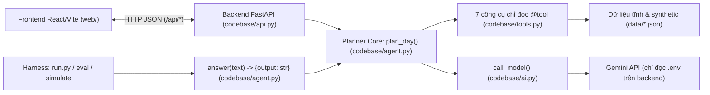

# Kiến trúc hệ thống — VinPlanner

> Tài liệu thiết kế kỹ thuật kết nối giao diện **VinPlanner (React/Vite + FastAPI)** với lõi **Planner + 7 công cụ chỉ đọc**, giữ nguyên **100% hợp đồng `answer(text) -> {"output": str}`** để `python run.py`, `python run.py eval` và `python run.py simulate` chạy đồng nhất.

---

## 1. Sơ đồ kiến trúc tổng thể



---

## 2. Nguyên tắc tách lớp & Bảo toàn Harness

Để giao diện web hiển thị bản đồ, thẻ mốc, bảng kiểm 5 điều kiện mà **không phải parse văn bản**, đồng thời không làm thay đổi cách chấm của khung hackathon:

1. **Lõi có cấu trúc (`plan_day` / `run_pipeline` trong `codebase/agent.py`):**
   - Thực hiện đủ 5 bước (Guardrail → Trích ràng buộc / G10 → Gọi công cụ đọc → Gọi Gemini lập lịch + `kiem_lich_trinh` sửa tối đa 2 vòng → Trả `dict` dữ liệu chuẩn gồm danh sách mốc, tổng chi phí, kết quả kiểm 5 điều kiện, `steps[5]`).
2. **Điểm vào CLI & Eval (`answer(text) -> {"output": str}`):**
   - Giữ nguyên chữ ký và hành vi cho `run.py`, `eval/run_eval.py`, `cost/simulate.py`: gọi lõi trên 1 ngày rồi định dạng thành chuỗi văn bản `output`.
   - Phần mở rộng **Ngày 2 / Ngày 3** trên web chỉ là vòng lặp gọi lại đúng hàm lõi `plan_day` theo từng ngày (kèm tham số ngày/thời tiết), **không** làm phình logic được chấm ở `answer(text)`.
3. **Điểm vào Web (`codebase/api.py`):**
   - Khởi tạo/cập nhật phiên người dùng, xử lý bước chọn thẻ khách sạn tham khảo (ngoài phạm vi đánh giá) và các thao tác tương tác trực tiếp trên UI (`swap`, `remove`, `undo`).

---

## 3. Danh sách 7 công cụ chỉ đọc (`codebase/tools.py`)

Tất cả công cụ đều gắn `@tool`, đọc dữ liệu từ `data/` và **không có tác động ra ngoài** (`Không`).

| # | Tên công cụ | Input | Output chính | Tác động ra ngoài? | Phạm vi chấm |
|---|---|---|---|---|---|
| 1 | `tra_diem_choi` | `phan_khu`, `chieu_cao_min`, `trong_nha`, `tags`, `mo_luc`, `gom_an_nghi` | Danh sách điểm/trò khớp từ `attractions.json` (kèm `x, y`, `min_height_cm`, `can_nguoi_lon_di_kem`) | Không | Trong phạm vi |
| 2 | `tra_lich_show` | `ngay`, `phan_khu`, `bo_qua_show` | Giờ mở cửa công viên/phân khu (`09:00–19:30` vs `10:00–18:00`), `show_kha_dung` (kèm `x, y`), `show_anh_huong_thoi_tiet` | Không | Trong phạm vi |
| 3 | `tra_thoi_tiet` | `ngay`, `khung_gio` | Trạng thái thời tiết, `co_mua`, `khung_gio_mua`, `dong_ngoai_troi`, `dong_cong_vien_nuoc` | Không | Trong phạm vi |
| 4 | `uoc_thoi_gian_di` | `khu_a`, `khu_b` | Thời gian đi bộ (phút) giữa 2 phân khu từ ma trận 6×6 | Không | Trong phạm vi |
| 5 | `tinh_chi_phi` | `so_nguoi_lon`, `so_tre_em_1m_1m4`, `so_tre_duoi_1m`, `dich_vu`, `so_nguoi_cao_tuoi`, `da_co_ve`, `goi_an`, `ngan_sach_vnd` | Chi phí vé, ăn uống, phụ phí, tiền cọc hoàn lại, `trong_ngan_sach`, `chenh_lech_ngan_sach_vnd` | Không | Trong phạm vi |
| 6 | `kiem_lich_trinh` | `lich`, `rang_buoc` | `hop_le`, `so_vi_pham`, `vi_pham[]`, `canh_bao[]`, `tong_hop_chi_phi`, `goi_y_trong_nha`, `goi_y_noi_rang_buoc` | Không | Trong phạm vi |
| 7 | `tra_khach_san` *(mới)* | `ngay_den`, `ngay_ve`, `so_nguoi` | 3–5 khách sạn gần cổng từ `data/hotels.json` (giá tham khảo có nguồn, khoảng cách cổng, `rooms_left` mô phỏng, `booking_url`, điểm phù hợp) | Không | **Ngoài phạm vi đánh giá** (chỉ phục vụ bước 1 UX trên web) |

---

## 4. Thay đổi & Bổ sung dữ liệu (`data/` + `data/DATA_CARD.md`)

Mọi file mới hoặc trường bổ sung đều phải cập nhật nguồn, ngày lấy và nhãn `thật` / `synthetic` vào [data/DATA_CARD.md](file:///d:/workspace/VinAI/K5-Day15-L3A-Phoenix_1/data/DATA_CARD.md).

1. **Bổ sung toạ độ sơ đồ SVG (`synthetic`, thang `0–100`):**
   - `data/park_zones.json`: thêm `bbox` / `polygon` và tâm khu cho 6 phân khu (`Z1_EURO`..`Z6_SEASHELL`) để vẽ bản đồ SVG 6 vùng.
   - `data/attractions.json` & `data/shows.json`: thêm `x`, `y` (trong phạm vi vùng của phân khu) để đặt thẻ mốc và vẽ đường nối lộ trình.
2. **`data/hotels.json` *(mới)*:**
   - Gồm 3–5 khách sạn tên thật gần cổng VinWonders Phú Quốc (khu Bãi Dài / Grand World).
   - Các trường: `id`, `name`, `distance_to_gate_m`, `price_ref_vnd`, `price_source_url` (link trang chính thức/OTA kèm ngày xem), `rooms_left` (**`synthetic`, `seed=42`** — UI luôn gắn nhãn *"mô phỏng"*), `max_guests`, `has_family_room`, `booking_url` (link trang chính thức cho nút **Đặt phòng ↗**), `fit_note`.
3. **`data/media.json` *(mới)*:**
   - Ánh xạ `item_id` → `image_url`, `youtube_url`, `source_url`, `verified_date`.
   - **Quy tắc chống bịa:** chỉ điền link chính thức từ VinWonders/Vinpearl do nhóm tự tìm và kiểm tra mở được; điểm nào chưa có media thì bỏ trống để khung chi tiết hiện *"Chưa có media"*.

---

## 5. Thiết kế API (`codebase/api.py` — FastAPI)

| Method & Path | Input | Hành vi & Output |
|---|---|---|
| `POST /api/chat` | `{ "session_id": str, "message": str }` | Chạy guardrail → trích/cập nhật ràng buộc phiên → nếu thiếu thông tin trả `status: "ask_more"`; nếu mới bắt đầu & đủ thông số gọi `tra_khach_san` trả `hotels[]`; nếu đã có khách sạn hoặc là câu hỏi chỉnh lịch thì chạy lại `plan_day` cho các ngày liên quan → trả `PlanResponse`. |
| `GET /api/hotels` | `?ngay_den=...&ngay_ve=...&so_nguoi=...` | Gọi `tra_khach_san` trả danh sách khách sạn tham khảo + nhãn mô phỏng. |
| `POST /api/sessions/{id}/hotel` | `{ "hotel_id": str }` | Ghi nhận khách sạn được chọn làm mốc xuất phát, sinh lịch Ngày 1..N bằng `plan_day`, đẩy snapshot vào undo stack → trả `PlanResponse`. |
| `GET /api/attractions/{id}` | `?heights=110,95` | Trả thông tin chi tiết điểm/show từ `attractions.json`/`shows.json` + media từ `media.json` + mảng `height_labels` (`✓`/`✗`) theo từng bé. |
| `GET /api/sessions/{id}/days/{n}/alternatives` | `?item_id=...` | Tìm các trò/điểm khác vừa khít khung giờ của `item_id` (lọc theo giờ mở cửa, chiều cao nhỏ nhất, trạng thái mưa của Ngày `n`, không trùng điểm đã có trong ngày). |
| `POST /api/sessions/{id}/days/{n}/swap` | `{ "item_id": str, "new_id": str }` | Lưu snapshot undo → thay `item_id` bằng `new_id` → **bắt buộc chạy lại `kiem_lich_trinh`**. Nếu phát sinh vi phạm → hoàn nguyên và trả lỗi kèm lý do; hợp lệ → trả `PlanResponse` mới kèm tin nhắn agent. |
| `POST /api/sessions/{id}/days/{n}/remove` | `{ "item_id": str }` | Lưu snapshot undo → xoá `item_id` theo **Luật xoá mốc** (mục 7) → **bắt buộc chạy lại `kiem_lich_trinh`** → trả `PlanResponse` mới. |
| `POST /api/sessions/{id}/undo` | `{}` | Pop snapshot trước đó từ undo stack của phiên → khôi phục trạng thái và trả `PlanResponse` (`can_undo` cập nhật). |

---

## 6. Schema `PlanResponse` (Hợp đồng Backend ↔ Frontend)

Backend và bộ mock `web/src/mock/plan.json` dùng đúng cấu trúc dưới đây để Frontend và Backend làm song song:

```json
{
  "session_id": "sess_abc123",
  "reply": "Mình đã xếp lịch Ngày 1 xuất phát từ VinHolidays Fiesta Phú Quốc (0 vi phạm).",
  "status": "ok",
  "missing_fields": [],
  "hotels": [
    {
      "id": "HT-01",
      "name": "VinHolidays Fiesta Phú Quốc",
      "distance_to_gate_m": 800,
      "price_ref_vnd": 1450000,
      "rooms_left": 3,
      "rooms_is_synthetic": true,
      "fit_score": 86,
      "fit_note": "Còn 3 phòng gia đình (mô phỏng) · 800m tới cổng",
      "booking_url": "https://vinpearl.com/..."
    }
  ],
  "selected_hotel_id": "HT-01",
  "days": [
    {
      "day": 1,
      "date": "2026-12-12",
      "weather": { "trang_thai": "nang_gat", "co_mua": false, "khung_gio_mua": null },
      "summary": {
        "cost_vnd": 3850000,
        "n_items": 9,
        "kid_ok_count": 4,
        "total_rides": 4
      },
      "items": [
        {
          "id": "VW-Z2-01",
          "type": "ride",
          "name": "Đu quay Thumbelina",
          "zone_id": "Z2_FAIRY",
          "start": "09:00",
          "end": "09:30",
          "x": 38,
          "y": 32,
          "cost_vnd": 0,
          "min_height_cm": 0,
          "height_labels": [
            { "child_cm": 110, "ok": true },
            { "child_cm": 95, "ok": true }
          ],
          "notes": "Trẻ dưới 100cm cần có người lớn ngồi cùng."
        }
      ],
      "check": {
        "hop_le": true,
        "so_vi_pham": 0,
        "vi_pham": [],
        "canh_bao": [],
        "dieu_kien": {
          "gio_mo_cua": true,
          "chong_gio": true,
          "ngan_sach": true,
          "chieu_cao": true,
          "mua": true
        }
      }
    }
  ],
  "steps": [
    { "step": 1, "name": "Kiểm tra an toàn đầu vào", "status": "ok", "detail": "Hợp lệ, trong phạm vi VinWonders Phú Quốc" },
    { "step": 2, "name": "Trích ràng buộc gia đình (G10)", "status": "ok", "detail": "2 lớn, 2 bé (110cm, 95cm), ngân sách 12tr" },
    { "step": 3, "name": "Gọi công cụ đọc dữ liệu", "status": "ok", "detail": "tra_thoi_tiet, tra_lich_show, tra_diem_choi, tinh_chi_phi" },
    { "step": 4, "name": "Lập lịch & kiểm cứng kiem_lich_trinh", "status": "ok", "detail": "0 vi phạm sau 0 vòng sửa" },
    { "step": 5, "name": "Tổng hợp lịch & chi phí", "status": "ok", "detail": "Đã xuất lịch kèm nhãn chiều cao từng bé" }
  ],
  "can_undo": true
}
```

- `status` thuộc tập: `"ok"` | `"ask_more"` | `"need_hotel"` | `"refused"` | `"infeasible"`.
- `items[].type` thuộc tập: `"hotel"` (nâu) | `"ride"` (xanh lá) | `"show"` (tím) | `"meal"` (cam).

---

## 7. Quản lý phiên, Hoàn tác & Luật xoá mốc

- **Phiên & Hoàn tác (Undo):** Server lưu trạng thái trong bộ nhớ (`SESSIONS: dict[str, SessionState]`). Mỗi `SessionState` giữ `constraints`, `selected_hotel_id`, `days`, `messages` và `undo_stack: list[Snapshot]` (tối đa 20 bước). Không cần cơ sở dữ liệu ngoài.
- **Lưu lịch:** Thực hiện hoàn toàn ở trình duyệt bằng `localStorage` kèm nút tải file `.json` lịch trình về máy.
- **Luật xoá mốc (`POST /api/sessions/{id}/days/{n}/remove`):**
  1. Xác định mốc đứng ngay trước mốc bị xoá (`prev_item`).
  2. Nếu `prev_item` tồn tại, **không phải** `type == "show"` (vì show diễn theo giờ cố định), và việc kéo `prev_item.end = removed_item.end` vẫn nằm trong giờ mở/đóng của phân khu `prev_item.zone_id` (và không vượt khung mưa nếu là ngoài trời) → kéo dài `prev_item.end` để gia đình đi thong thả hơn.
  3. Ngược lại (xoá mốc đầu ngày, hoặc `prev_item` là show cố định / kịch giờ đóng phân khu) → chèn hoặc giữ khoảng trống ghi nhãn *"Thời gian nghỉ / di chuyển tự do"*.
  4. Bắt buộc chạy lại `kiem_lich_trinh` trước khi trả về UI.

---

## 8. Cấu trúc Frontend (`web/` — React + Vite)

```text
web/
├── vite.config.js               # proxy "/api" -> "http://localhost:8000"
└── src/
    ├── App.jsx                  # Layout chia đôi (ChatPanel | ItineraryPanel)
    ├── mock/plan.json           # Dữ liệu mẫu khớp PlanResponse để phát triển song song
    ├── components/
    │   ├── ChatPanel.jsx        # MessageList, HotelCards, StepsDrawer (5 bước), QuickReplies, Composer, UndoBtn
    │   ├── ItineraryPanel.jsx   # DayTabs (Ngày 1/2/3), DaySummaryBar (chi phí, số mốc, hợp bé, Đặt phòng ↗, Lưu lịch)
    │   ├── ParkMapSvg.jsx       # Bản đồ SVG 6 phân khu, 4 màu mốc, đường nối tuyến, LegendChips, nút Google Maps ↗
    │   ├── TimelineStrip.jsx    # Dải thẻ mốc cuộn ngang dưới bản đồ
    │   ├── CheckModal.jsx       # Bảng tự kiểm 5 điều kiện mở từ nút "0 vi phạm · N lưu ý"
    │   └── ItemDetailModal.jsx  # Media (hoặc "Chưa có media"), thông tin, nhãn chiều cao, SwapList, nút Xoá mốc
```

---

## 9. Cách chạy dự án

- **Chế độ chấm & đánh giá chuẩn của hackathon (giữ nguyên 100%):**
  ```powershell
  python run.py check
  python run.py eval --try
  python run.py eval
  python run.py score eval/run-1.csv
  python run.py simulate --try
  ```
- **Chế độ giao diện web VinPlanner (sau khi hoàn thành T3 & T5–T6):**
  ```powershell
  pip install -r requirements.txt
  uvicorn codebase.api:app --reload --port 8000
  # Terminal thứ hai:
  cd web && npm install && npm run dev
  ```

---

## 10. Rủi ro kỹ thuật & An toàn cần xử lý khi code

1. **Xung đột Guardrail từ khoá `"khách sạn"` (B12 vs luồng chọn khách sạn trên web):**
   - Hiện `_check_input_guardrail` trong `codebase/agent.py` đang chặn mọi input chứa `"khach san"`.
   - **Cách xử lý:** Trên web, việc chọn khách sạn đi qua endpoint riêng `POST /api/sessions/{id}/hotel` (hoặc context nội bộ), còn `_check_input_guardrail` chỉ chặn **ý định đặt/thanh toán** (vd *"đặt giúp khách sạn"*, *"đặt phòng"*, *"vé máy bay"*, số thẻ) để câu tấn công `B12` vẫn bị từ chối đúng 100%.
2. **Bảo mật API Key:** Key Gemini chỉ nằm trong `.env` ở máy chủ Backend (`.gitignore` đã chặn `.env`), tuyệt đối không gửi key xuống frontend React và không commit `.env`.
3. **Toàn vẹn đánh giá:** Tuyệt đối không sửa `eval/metric_spec.yaml` hay chuẩn "đạt" ở `spec.md` §7; `eval/benchmark.csv` chỉ thêm mới câu thử cho CP3 (20–30 câu), không sửa `expected` hay xoá câu trượt.
4. **Tính trung thực dữ liệu UI:** Mọi con số giờ/giá/chiều cao trên giao diện phải lấy từ tool; `rooms_left` từ `hotels.json` bắt buộc hiển thị nhãn *"dữ liệu mô phỏng"*.
