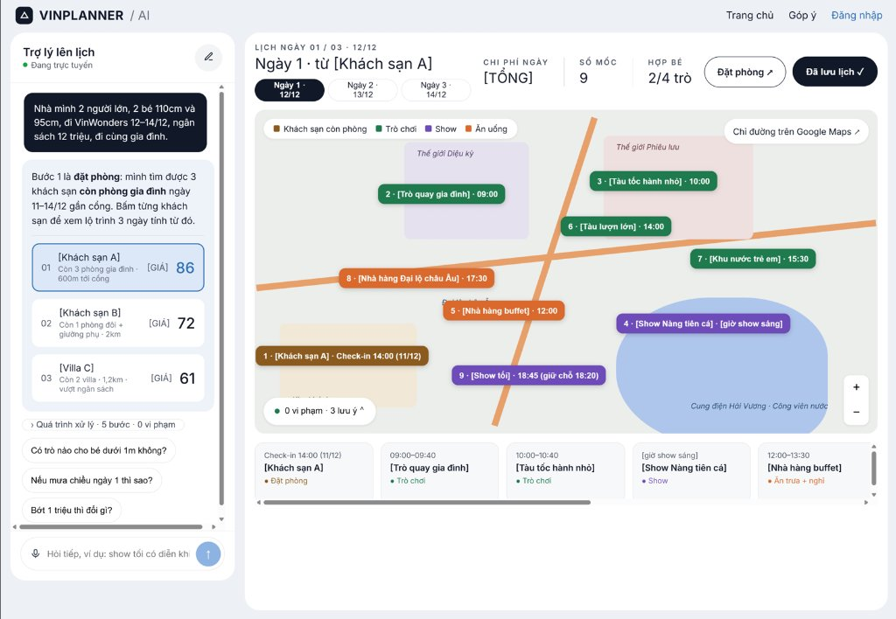

# VinPlanner — Mô tả sản phẩm

> **Một câu:** **VinPlanner** là trợ lý lên & tái lập lịch trình tham quan VinWonders Phú Quốc có kiểm chứng ràng buộc bằng dữ liệu và code, giúp gia đình (nhất là gia đình có trẻ nhỏ) tránh lỡ show, tránh quá sức và kiểm soát chi phí phát sinh.

---

## 1. Người dùng mục tiêu

- **Người dùng chính (trong phạm vi đánh giá):** Gia đình có trẻ nhỏ (chưa đủ chiều cao `1,0m–1,4m` cho nhiều trò cảm giác mạnh) đi **VinWonders Phú Quốc** trong 1 ngày với ngân sách và khung giờ cố định.
- **Người dùng phụ (mở rộng UX, không nằm trong bộ chấm):** Nhóm bạn trẻ, cặp đôi hoặc người đi một mình muốn gom nhóm trò chơi hợp lý theo khung giờ mở cửa và thời tiết.

---

## 2. Chỗ đau & Bằng chứng hiện có

Hiện nay khách phải tự ghép lịch giữa hơn 100 trò trên khuôn viên ~50 ha có 6 phân khu đóng/mở lệch giờ nhau (`09:00–19:30` vs `10:00–18:00`), show cố định chỉ diễn `10–20 phút`, từng trò có giới hạn chiều cao riêng, nắng gắt trưa hoặc mưa bất chợt làm đóng trò ngoài trời, và nhiều chi phí phát sinh bên trong (ăn uống, xe đẩy, tủ đồ, buggy, Fastpass).

Số liệu nhóm đã thu thập đến CP2 (không thêm số ước lượng mới ngoài repo):
- **Đào 60 review 1–3 sao công khai** trên Tripadvisor (40) & Google Maps (20) ([evidence/data-mining.md](file:///d:/workspace/VinAI/K5-Day15-L3A-Phoenix_1/evidence/data-mining.md)): **`24/60 (40%)`** nhắc ít nhất 1 trong 5 lỗi sắp lịch. Nhiều nhất là **chi phí phát sinh `9/60 (15%)`**, sau đó đến **chiều cao trẻ em `7/60 (12%)`**, **nắng/mưa `6/60 (10%)`**, **lỡ/khó xem show `5/60 (8%)`**, **quá rộng `2/60 (3%)`** (`36/60` còn lại phàn nàn thái độ nhân viên, trò bảo trì…).
- **Khảo sát bước đầu** ([evidence/survey/results.csv](file:///d:/workspace/VinAI/K5-Day15-L3A-Phoenix_1/evidence/survey/results.csv), `9` phiếu — chưa đạt ngưỡng 20, tiếp tục gom trước CP3): `6/9` phiếu đúng đối tượng đã đi công viên chủ đề cùng trẻ nhỏ, trong đó **`6/6` chi tiêu vượt dự tính** (`3/3` phiếu không mâu thuẫn).

---

## 3. Lát cắt được chấm & Phạm vi đánh giá

> **Lát cắt MỘT CÂU (giữ nguyên từ CP2 — [canvas.md](file:///d:/workspace/VinAI/K5-Day15-L3A-Phoenix_1/canvas.md#L13)):** *Một gia đình có trẻ nhỏ · nhập số người, chiều cao từng bé, ngân sách (gồm ăn uống/phụ phí), khung giờ và tình huống thời tiết/hủy show · AI tra dữ liệu điểm chơi/giờ show/giá vé/thời tiết, xếp thứ tự và tự kiểm mọi ràng buộc bằng công cụ (hoặc kết luận không xếp được kèm gợi ý nới ràng buộc) · gia đình nhận lịch trình từng giờ hợp lệ kèm bảng dự toán chi phí chi tiết và lý do chọn.*

| Trong phạm vi đánh giá (`eval/` & `spec.md` §7) | Ngoài phạm vi đánh giá (lớp trình bày UI & tiện ích mở rộng) |
|---|---|
| Lập & tái lập lịch **1 ngày** tại VinWonders Phú Quốc cho gia đình có trẻ nhỏ (`answer(text)`). | Tab **Ngày 2 / Ngày 3** trên giao diện web (chạy lại đúng luồng lập lịch 1 ngày cho từng ngày). |
| Kiểm 5 điều kiện cứng bằng code (`kiem_lich_trinh`): giờ mở cửa, chồng giờ/đi bộ, ngân sách, chiều cao từng bé, mưa. | **Bước 1 thẻ 3 khách sạn gần cổng**: chỉ đọc dữ liệu tham khảo để lấy điểm xuất phát & ước lượng tổng chuyến, **không đặt phòng**. |
| Hỏi lại 1 lần khi thiếu thông tin (G10); báo không xếp được + gợi ý nới ràng buộc khi bất khả thi; từ chối tấn công/đặt vé/sai giờ (`B11`, `B12`). | Khung xem video/ảnh minh hoạ địa điểm; nút **Lưu lịch** trên trình duyệt (`localStorage` / xuất JSON). |

---

## 4. Wireframe & Thiết kế màn hình chia đôi

### 4.1. Nửa bên trái — Chat với Agent
1. **Nhập bằng lời thường:** Người dùng nhắn tự do số người lớn/trẻ em, chiều cao từng bé, ngày đi–về, ngân sách, đi cùng ai. Nếu thiếu thông tin quan trọng (số người, chiều cao bé, khung giờ, ngân sách), agent **hỏi lại 1 lần** liệt kê rõ các trường thiếu; nếu người dùng trả lời bổ sung vẫn còn thiếu, agent nói rõ chưa thể lập lịch và không tự đoán.
2. **Bước 1 chọn chỗ ở (thẻ tham khảo, ngoài phạm vi đánh giá):** Agent gọi tool chỉ đọc `tra_khach_san` gợi ý 3 khách sạn gần cổng. Mỗi thẻ hiển thị tên khách sạn, số phòng trống *(gắn nhãn dữ liệu mô phỏng)*, khoảng cách tới cổng, giá tham khảo và điểm phù hợp. Người dùng bấm chọn 1 khách sạn để khởi tạo lịch cho các ngày tham quan (agent **không** đặt phòng).
3. **Tương tác chỉnh sửa & minh bạch:** Mỗi lần lịch thay đổi theo câu hỏi nối tiếp (vd *"Nếu mưa chiều ngày 1 thì sao?"*, *"Bớt 1 triệu thì đổi gì?"*), agent nhắn lại tóm tắt thay đổi kèm nút **Hoàn tác** và thanh **Quá trình xử lý · 5 bước · 0 vi phạm** cho phép mở xem 5 bước agent vừa thực hiện.

### 4.2. Nửa bên phải — Lộ trình trên bản đồ
1. **Thanh tiêu đề & điều khiển trên cùng:** Tab chuyển **Ngày 1 / Ngày 2 / Ngày 3**, tổng **Chi phí ngày**, **Số mốc**, chỉ số **Hợp bé (`x/y` trò)**, nút **Đặt phòng ↗** *(chỉ mở trang đặt phòng chính thức, không tự thanh toán)* và nút **Lưu lịch**.
2. **Bản đồ sơ đồ SVG 6 phân khu:** Hiển thị trực quan 6 phân khu của VinWonders Phú Quốc, đánh dấu các mốc theo **4 màu riêng** (nâu: khách sạn · xanh lá: trò chơi · tím: show · cam: ăn uống) và nối tuyến theo thứ tự thời gian trong ngày; kèm nút **Chỉ đường trên Google Maps ↗** (mở link ngoài).
3. **Dải thẻ mốc dưới bản đồ:** Cuộn ngang danh sách các mốc kèm khung giờ, tên điểm và phân loại để bấm xem chi tiết hoặc theo dõi nhanh thứ tự trong ngày.

### 4.3. Khung chi tiết mốc & Bảng tự kiểm 5 điều kiện
- **Khung chi tiết lớn khi bấm vào 1 mốc:**
  - Hiển thị **video/ảnh chính thức** của điểm chơi/show (nếu chưa có link chính thức thì hiển thị ô *"Chưa có media"* — không bịa hoặc chèn ảnh không rõ nguồn), mô tả ngắn, giờ mở cửa.
  - **Nhãn chiều cao từng bé** (ví dụ: `Bé 110cm ✓ · bé 95cm ✗`) tính trực tiếp từ `min_height_cm` trong dữ liệu.
  - **Đổi sang trò khác cùng khung giờ:** Gọi API lấy các trò thay thế cùng khung giờ đã lọc qua chiều cao, giờ mở cửa và thời tiết để đổi nhanh không gây chồng giờ.
  - **Xoá mốc:** Xoá mốc khỏi lịch; hệ thống nhường khoảng thời gian trống cho mốc liền trước để gia đình đi thong thả hơn (nếu mốc liền trước là show có giờ cố định hoặc kịch giờ đóng cửa phân khu thì chuyển khoảng trống đó thành **thời gian nghỉ**), rồi tự kiểm lại bằng `kiem_lich_trinh`.
- **Nút `0 vi phạm · N lưu ý`:** Mở bảng tự kiểm gồm 5 điều kiện (**giờ mở cửa**, **chồng giờ**, **ngân sách**, **chiều cao**, **mưa**) và liệt kê chi tiết từng lưu ý (vd trẻ cần người lớn đi kèm, cảnh báo nắng gắt 11:00–15:00, cần đến sớm trước giờ show).

---

## 5. Điểm khác biệt so với ChatGPT hay Blog

1. **Số liệu lấy từ công cụ, không tự nhớ:** Giờ mở cửa, giờ show, chiều cao tối thiểu và giá vé/ăn uống đều đọc từ bộ công cụ tra cứu dữ liệu; không có dữ liệu (như thời gian xếp hàng thực tế) thì nói rõ không có.
2. **Kiểm cứng bằng code trước khi trả:** Mọi lịch trình dù do AI tạo hay do người dùng Đổi/Xoá trên UI đều đi qua `kiem_lich_trinh` để đảm bảo 0 vi phạm giờ mở cửa, chồng giờ, ngân sách, chiều cao và mưa.
3. **Hỏi lại khi thiếu, nói thẳng khi bất khả thi:** Tuân thủ nguyên tắc HAX G10 — không đoán bừa khi thiếu thông số gia đình và không xếp cố khi quá gắt (vd 3 tiếng đòi đi 6 khu, ngân sách thấp hơn tiền vé).
4. **Không tự đặt phòng hay thanh toán:** Agent chỉ gợi ý và mở link tham khảo tới trang chính thức; người dùng luôn là người duyệt và quyết định cuối cùng.

---

## 6. Những việc VinPlanner KHÔNG làm

- Không tự đặt phòng khách sạn, đặt vé vào cổng, vé máy bay hay thực hiện thanh toán.
- Không thu thập, yêu cầu hoặc xử lý số thẻ ngân hàng, mã CVV, mã OTP hay thông tin cá nhân nhạy cảm.
- Không bịa thời gian xếp hàng thực tế theo thời gian thực hay trạng thái bảo trì chưa có trong dữ liệu.
- Không xếp trẻ em vào trò chơi vượt quá giới hạn chiều cao quy định khi không có phương án tách nhóm hợp lệ.

---

## 7. Dữ liệu thật vs Dữ liệu mô phỏng (`synthetic`)

| Thành phần dữ liệu | Trạng thái | Nguồn & ghi chú |
|---|---|---|
| Giờ mở cửa 6 phân khu, lịch 6 show cố định 2026, giá vé vào cổng/buffet | **Thật** | Trang chính thức `vinwonders.com` (kiểm & chụp màn hình ngày 27/11/2026, `docs/images/`) |
| Quy mô & tên điểm chơi nổi bật, ngưỡng chiều cao tiêu biểu | **Thật** *(kết hợp chuẩn hoá)* | Tổng hợp nguồn công khai (`vinwonders.com`, `data/DATA_CARD.md`) |
| Thời lượng từng trò, ma trận đi bộ 6×6, toạ độ `x, y` trên bản đồ SVG | **`synthetic`** | Nhóm chuẩn hoá theo quy hoạch 6 phân khu để chạy mô phỏng & vẽ tuyến |
| Kịch bản thời tiết theo ngày (`data/weather.json`) | **`synthetic` (`seed=42`)** | Sinh có seed theo mùa khô/mưa Phú Quốc để kiểm thử tái lập lịch |
| Danh sách khách sạn (`data/hotels.json`) | **Giá/tên thật · Phòng trống `synthetic`** | Tên & giá tham khảo có link nguồn công khai; số phòng trống mô phỏng (`seed=42`), UI gắn nhãn *"dữ liệu mô phỏng"* |
| Media (video/ảnh điểm chơi trong khung chi tiết) | **Thật hoặc trống** | Chỉ dùng link YouTube/ảnh chính thức từ VinWonders; thiếu thì hiện *"Chưa có media"* |
