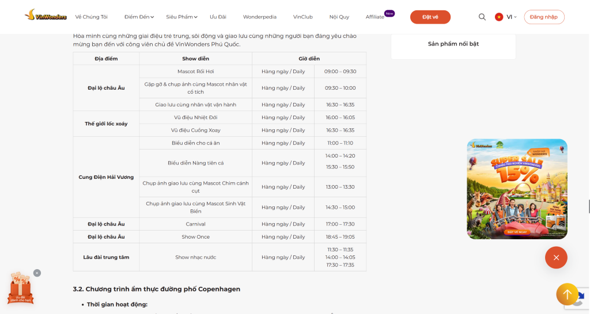
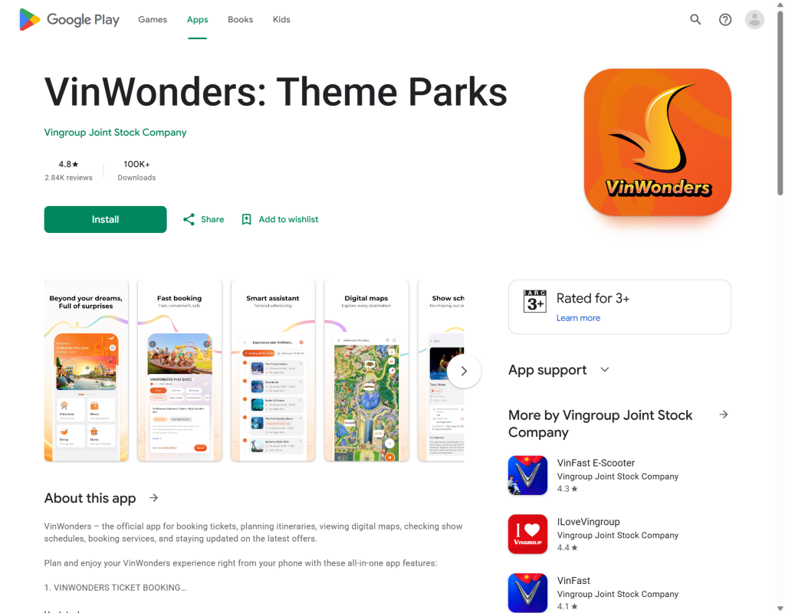
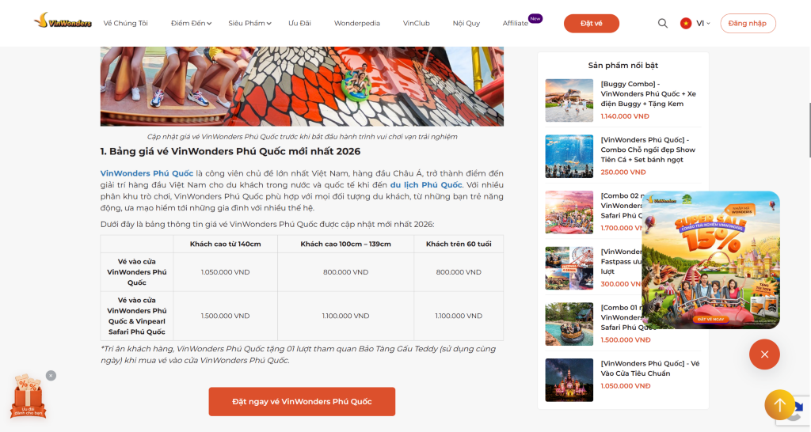

# AI SPEC — Lập & tái lập lịch trình 1 ngày VinWonders Phú Quốc · Nhóm Phoenix_1 · Phòng H210 · Zone 3

> Mốc nộp: §7 chốt chuẩn "đạt" tại **CP2 19:30 Thứ Sáu 27/11** · §0–§7 nộp **CP3 10:00 Thứ Bảy 28/11** · đủ §0–§10 **CP4 14:30 Thứ Bảy 28/11** · §10 changelog ghi tiếp đến **23:59 Thứ Bảy 28/11**. Đầu mỗi mục ghi bước guide (`02-guide.md` trong repo đề) chỉ cách điền. Mỗi mục ngắn, có số và nguồn; chi tiết để ở file được trỏ tới. Xoá dòng hướng dẫn trong ngoặc vuông khi điền xong.

Track: \[ \] A · \[ \] B · \[x\] C · \[ \] D · \[ \] E — bài toán: C1 · Lập và tái lập lịch trình một ngày tại VinWonders Phú Quốc Data BTC cấp đã dùng (nếu có — không commit nguyên file): Không (Track C nhóm tự thu review công khai làm bằng chứng ở `evidence/` và tự dựng dữ liệu chạy thử có seed theo thông tin vận hành công khai của VinWonders Phú Quốc ở `data/`).

## §0. Hiện tại việc này diễn ra thế nào _(guide 1.1)_

- Luồng hiện tại của việc này, trong khoá hoặc trên app thật (3–5 bước; ảnh chụp từ tài khoản của mình, đã che thông tin):
    1. Trước chuyến đi: tìm đọc blog kinh nghiệm/hội nhóm và mua vé điện tử qua app/OTA.
    2. Tới cổng (09:00): lấy bản đồ giấy hoặc mở app VinWonders, thuê xe đẩy nếu đi cùng trẻ nhỏ (\~50.000–100.000đ).
    3. Tự ghép lộ trình đi bộ qua 6 phân khu (\~50 ha, >100 trò/trải nghiệm) có giờ mở cửa lệch nhau (toàn công viên 09:00–19:30; Cung điện Hải Vương & Công viên nước 10:00–18:00), tự canh giờ show (Nàng tiên cá 11:00–11:10 và 14:00–14:10, cho cá ăn 15:00–15:15, Once Show 18:45–19:05 hoặc 19:00–19:20) và tự lọc giới hạn chiều cao trẻ em (1,0m–1,4m+).
    4. Tự tính ăn uống và chi phí phát sinh bên trong (quy định không mang đồ ăn mặn ngoài vào; buffet \~350.000đ/người lớn, món lẻ 150.000–350.000đ, tủ gửi đồ 20.000–40.000đ, xe buggy/Fastpass).
    5. Khi nắng gắt (11:00–15:00), mưa lớn làm tạm dừng trò ngoài trời hoặc xếp hàng lâu, khách phải tự xoay lịch thủ công.
- Ảnh chụp màn hình nguồn công khai minh hoạ hiện trạng (chụp ngày `27/11/2026`, không chứa thông tin cá nhân):
  - **Lịch biểu diễn show & giờ mở cửa 2026** (cho cá ăn `11:00–11:10`, Nàng tiên cá `14:00–14:20` & `15:30–15:50`, Show Once `18:45–19:05`, Show nhạc nước `11:30 / 14:00 / 17:30`) — nguồn: `https://vinwonders.com/vi/wonderpedia/news/lich-trinh-vinwonders-phu-quoc/`:
    
  - **Ứng dụng chính thức *VinWonders: Theme Parks* trên Google Play** (`4.8★`, `100K+` lượt tải; có Đặt vé, Smart assistant, Digital maps, Show schedule) — nguồn: `https://play.google.com/store/apps/details?id=com.vinwonders.app`:
    
  - **Bảng giá vé VinWonders Phú Quốc mới nhất 2026** (Người lớn ≥140cm `1.050.000đ`, Trẻ em 100–139cm & Trên 60 tuổi `800.000đ`, kèm gói Buggy/Fastpass ở cột sản phẩm nổi bật) — nguồn: `https://vinwonders.com/vi/wonderpedia/news/gia-ve-vinwonders-phu-quoc-combo-voucher-hot/`:
    
- Công cụ / AI đang được dùng cho việc này (nếu có) + nguồn. Không kiểm được thì ghi "chưa kiểm": App chính thức _VinWonders: Vé & Trải nghiệm_ (Google Play / App Store, kiểm 27/11/2026) có bản đồ số, lịch show, trạng thái trò mở/bảo trì và gợi ý hành trình cơ bản, nhưng chưa tối ưu đồng thời theo ngân sách tổng + chiều cao từng thành viên và chưa tự tái lập lịch khi mưa/hủy show/còn ít giờ; ngoài ra khách thường dùng blog du lịch (dễ cũ giờ show) hoặc ChatGPT phổ thông (dễ bịa giờ mở cửa/giá vé, không kiểm ràng buộc bằng công cụ).

## §1. Người dùng & bằng chứng _(guide 1.1, 1.2)_

- Người dùng chính (một vai cụ thể): Gia đình có trẻ nhỏ (cao dưới 1,4m) đi VinWonders Phú Quốc lần đầu trong 1 ngày với ngân sách và khung giờ cố định.
- Việc họ cố làm xong (`động từ + đối tượng + bối cảnh`, không có chữ AI): Lập và điều chỉnh lịch trình vui chơi 1 ngày tại VinWonders Phú Quốc để cả gia đình (gồm trẻ nhỏ) chơi được nhiều điểm phù hợp nhất, không lỡ show chính, không kiệt sức vì nắng/đi vòng và không vượt ngân sách.
- Hôm nay họ giải bằng gì, hỏng ở đâu, vì sao chưa bỏ: Đọc blog kinh nghiệm, dùng tờ bản đồ giấy tại cổng, app VinWonders hoặc hỏi ChatGPT. Hỏng ở chỗ blog nhanh lỗi thời; tự ghép tay dễ chồng giờ, sai khung mở cửa giữa các khu (10:00–18:00 vs 09:00–19:30), lỡ show ngắn (10 phút) hoặc vướng chiều cao bé; ChatGPT dễ bịa giờ/giá; gặp mưa đột ngột không có phương án xếp lại nhanh. Chưa bỏ vì miễn phí, quen tay và chưa có công cụ vừa nắm dữ liệu công viên vừa tự kiểm ràng buộc theo gia đình.
- Pain (KHÔNG chữ AI): Gia đình có trẻ nhỏ đi VinWonders Phú Quốc lần đầu phải tự ghép lịch cho hơn 100 điểm/trò trên khuôn viên \~50 ha có giờ mở cửa phân khu lệch nhau (9:00–19:30 vs 10:00–18:00), giới hạn chiều cao (1,0m–1,4m), lịch show cố định ngắn (Nàng tiên cá 10 phút, Once Show 1 suất tối) và nắng/mưa thất thường → hậu quả là đi vòng vèo kiệt sức, bỏ lỡ show chính, vỡ ngân sách phát sinh hoặc vỡ toàn bộ lịch khi trời mưa.
- Bằng chứng — số chính + kết luận (chi tiết: `evidence/summary.md`): _(Nháp CP1 — đang thu thập)_ Đã chốt giả thuyết ở `evidence/hypothesis.md` và khảo sát thông số công khai (quy mô, giờ mở cửa, lịch show, bảng giá, 5 cụm phàn nàn trên Tripadvisor/Klook/Traveloka). Số đếm chính thức `x/N` từ ≥60 review công khai (`evidence/data-mining.md`) và phỏng vấn ≥3 người ngoài nhóm / khảo sát ≥20 người (`evidence/summary.md`) sẽ cập nhật tại CP2–CP3.

## §2. Impact & quyết định chọn _(guide 1.3)_

| Hướng                                                               | Bao nhiêu người gặp                                                                                                                 | Bao nhiêu lần / tháng                | Mỗi lần tốn gì                                                                                    | Impact / tháng                                                         | Làm kịp không                                                           | Chọn?    |
| ------------------------------------------------------------------- | ----------------------------------------------------------------------------------------------------------------------------------- | ------------------------------------ | ------------------------------------------------------------------------------------------------- | ---------------------------------------------------------------------- | ----------------------------------------------------------------------- | -------- |
| C1 · Lập & tái lập lịch trình 1 ngày tại VinWonders Phú Quốc        | \~57.000 lượt/tháng (\~14.250 gia đình có trẻ nhỏ đi lần đầu) _(tự ước tính từ >8,57 triệu khách Phú Quốc 9T/2026, VietnamPlus)_ | 1 lần/chuyến _(tự ước tính)_         | \~75 phút tự ghép lịch, đi vòng & xoay sự cố + rủi ro lỡ show/vỡ ngân sách _(tự ước tính)_        | \~1.068.750 phút (\~17.812 giờ)/tháng _(tự ước tính)_                  | Có — dữ liệu công khai rõ ràng, dễ gặp người dùng & kiểm cứng bằng code | **Chọn** |
| C3 · Hỗ trợ hành khách bị hủy chuyến bay (giữ chỗ, đổi vé, hoàn vé) | Khách bay nội địa/OTA bị hủy chuyến sát giờ _(tự ước tính)_                                                                         | 1–2 lần/năm/người _(tự ước tính)_    | Mất suất chuyến sớm, mất lượt đổi miễn phí hoặc chờ hoàn tới 90 ngày (Traveloka help, 11/11/2026) | Cao theo sự cố nhưng ít người quanh nhóm vừa gặp trong 1 tháng gần đây | Kém hơn C1 — ít đầu mối phỏng vấn trực tiếp & user testing trong 2 ngày | Loại     |
| C2 · Đề xuất đổi/nâng hạng phòng cho lễ tân khách sạn               | Lễ tân ca trực tại khách sạn/resort _(tự ước tính)_                                                                                 | Nhiều ca/ngày/lễ tân _(tự ước tính)_ | Mất thời gian tra phòng trống xuyên suốt kỳ ở, dễ tính sai phí chênh                              | Cao trong vận hành khách sạn _(chưa kiểm chứng được quy mô)_           | Không — bắt buộc phỏng vấn ≥3 lễ tân thật (rủi ro thiếu bằng chứng R1)  | Loại     |

- **Impact / tháng** của hướng chọn = \~14.250 gia đình/tháng × 1 lần/tháng × \~75 phút = \~1.068.750 phút (\~17.812 giờ)/tháng — nguồn từng thừa số: lượng khách Phú Quốc 9 tháng đầu 2026 ước >8,57 triệu lượt ≈ \~950.000 lượt/tháng (VietnamPlus, kiểm 27/11/2026); tỉ lệ ghé VinWonders \~20%, tỉ lệ gia đình có trẻ nhỏ đi lần đầu \~30% (\~4 người/gia đình), số lần/tháng và \~75 phút lãng phí là _(tự ước tính — sẽ hiệu chuẩn lại bằng phỏng vấn/khảo sát ở bước 1.2)_. Ngoài thời gian, chi phí vé + ăn uống/phát sinh của 1 gia đình 4 người ước tính \~3,5–5 triệu/ngày (tổng hợp bảng giá VinWonders/Rooty Trip/DuLich9, kiểm 27/11/2026).
- Hướng ĐÃ LOẠI + vì sao (giữ lại, đừng xoá):
    - **C2 (Lễ tân khách sạn):** Bắt buộc phải có bằng chứng từ chính lễ tân thật (review của khách không thay thế được), mà nhóm chưa có sẵn ≥3 lễ tân quen để phỏng vấn trong 2 ngày → rủi ro lớn ở tiêu chí R1.
    - **C3 (Chuyến bay bị hủy):** Tuy pain rất gắt, nhưng số người quanh nhóm trực tiếp bị hủy chuyến sát giờ trong 1 tháng qua ít hơn hẳn số người từng đi công viên chủ đề lớn → C1 thuận lợi hơn để thu đủ bằng chứng phỏng vấn/khảo sát và chạy user testing (Bonus +5đ).
- Số lần / tháng của từng kiểu người dùng (dùng cho persona ở §8): Khách lập lịch 1 lần trước chuyến đi (1 phiên/chuyến) · Gia đình cân nhắc chỉnh nhiều phương án trước ngày đi (2–3 phiên/chuyến) · Gia đình gặp mưa/hủy show phải tái lập lịch nhiều vòng giữa ngày (3–5 phiên/chuyến, cao điểm mùa mưa tháng 5–10) _(tự ước tính, sẽ kiểm chứng qua khảo sát)_.

## §3. Giải pháp tương tự _(guide 2.1)_

-

\[
sản phẩm / tính năng gần giống
\]

## §4. Thiết kế _(guide 2.2, 3.2)_

- **Lát cắt MỘT CÂU** (1 người dùng · 1 việc · 1 quyết định AI · 1 kết quả):

- Không làm (≥3 điều):

- **Sơ đồ** (ảnh / Mermaid / draw.io): \[chèn ở đây\]

- **Hình dạng:** \[ \] workflow cố định · \[ \] một agent · \[ \] nhiều agent — 2 dòng lý do, và vì sao **không** chọn hình dạng phức tạp hơn:

- **AI dựa vào đâu** — mỗi công cụ (khớp `codebase/tools.py`):

    | Công cụ | Input | Output | Tác động ra ngoài? |
    | ------- | ----- | ------ | ------------------ |
    |         |       |        |                    |

- **Mức tự động:** \[ \] AI gợi ý, người quyết · \[ \] AI tự làm khi chắc, chuyển người khi không · \[ \] AI tự làm — lý do (sai thì ai chịu gì, sửa đắt hay rẻ):

- **Chỗ chặn rủi ro** (rủi ro lớn nhất của lát cắt bị chặn ở đâu, bằng gì):

- **Chỗ người duyệt** (việc AI không được tự làm):

- **Nguyên tắc thiết kế** (≥3, bắt buộc G10):

    | Nguyên tắc                           | Chỗ cụ thể trên sơ đồ / trong bản chạy thử |
    | ------------------------------------ | ------------------------------------------ |
    | G10 — thu hẹp phạm vi khi không chắc |                                            |
    |                                      |                                            |
    |                                      |                                            |

- Phần nào còn giả (công cụ trả dữ liệu giả, model chế độ giả…) — ghi rõ, không giả làm thật:

## §5. Chỗ khó — 4 lớp + ≥6 kịch bản + 2 tấn công _(guide 2.3)_

| Kịch bản     | Lớp (1–4) | Hành vi mong muốn (nói gì, hiện gì, cho làm gì tiếp) | Câu thử |
| ------------ | --------- | ---------------------------------------------------- | ------- |
|              |           |                                                      |         |
| _(tấn công)_ |           |                                                      |         |
| _(tấn công)_ |           |                                                      |         |

(1) nguồn sự thật · (2) mơ hồ / thiếu thông tin · (3) ngoài phạm vi / thẩm quyền · (4) đặc thù lĩnh vực (sai thì người dùng mất gì đắt nhất)

## §6. Bốn đường đi của trải nghiệm

- Mọi thứ suôn sẻ: · Không chắc (lớp 2): · Không có căn cứ (lớp 1): · Người dùng sửa:
- Bị đòi ngoài phạm vi (lớp 3): · Trường hợp đặc thù lĩnh vực (lớp 4):

## §7. Đánh giá & chuẩn "đạt" _(guide 2.4, 4.1)_

- Data card: `data/DATA_CARD.md` · bộ câu thử: `eval/benchmark.csv` — \_\_ câu (thuong \_\_ · kho \_\_ · tu_choi **) · metric:** `eval/metric_spec.yaml` **(** metric)
- **Chuẩn "đạt"** (chốt **trước 19:30 Thứ Sáu 27/11**, giữ nguyên đến 23:59 Thứ Bảy 28/11): "Đạt khi ≥ \_\_% câu qua, và \_\_"
- Kết quả: lượt 1 **/** (**%) · lượt 2 / (**%) — run ID: \_\_ / \_\_ → chi tiết `eval/report.md`, hồ sơ `eval/README.md`

## §8. Chi phí khi dùng thật _(guide 4.2)_

- Persona + giá: `cost/personas.yaml` · lượt mô phỏng: `cost/simulate-__.csv` (\_\_ phiên)
- Chi phí / task thành công: \_\_ (model \_\_) · \_\_ (model \_\_)
- Chi phí / tháng ở quy mô thật: thấp \_\_ · cơ sở \_\_ · cao \_\_ → chi tiết `cost/cost-estimate.md`
- So với impact / người / tháng (§2): đáng làm không, vì sao:

## §9. Rủi ro & an toàn

- Dữ liệu: đã ẩn danh gì, không thu gì, không đưa gì vào model gói miễn phí:
- AI **không được** làm gì kể cả khi người dùng yêu cầu:
- Ai có thể bị hại nếu AI sai, và nhóm chặn thế nào:

## §10. Phân công & changelog

- Phân công có tên (theo chặng, chia cặp — guide "Cách chia việc"): \_\_
- Dùng AI vào việc gì (2–3 dòng; chi tiết `docs/ai-usage.md`):
- Nhật ký thay đổi — **mọi thay đổi sau CP2 19:30 Thứ Sáu 27/11 phải có dòng ở đây**:

**CP2 → CP4** (vd thu hẹp lát cắt, hỏi thêm người dùng, lần cải tiến trước lượt 2)

| Thời điểm | Đổi gì | Vì sao (trỏ về câu thử / lỗi / bằng chứng nào) |
| --------- | ------ | ---------------------------------------------- |
|           |        |                                                |

**Sau CP4 (đến 23:59 Thứ Bảy 28/11)** (sửa theo góp ý — không sửa chuẩn "đạt", câu thử, số bằng chứng, kết quả các lượt đã chạy)

| Thời điểm | Đổi gì | Vì sao |
| --------- | ------ | ------ |
|           |        |        |
